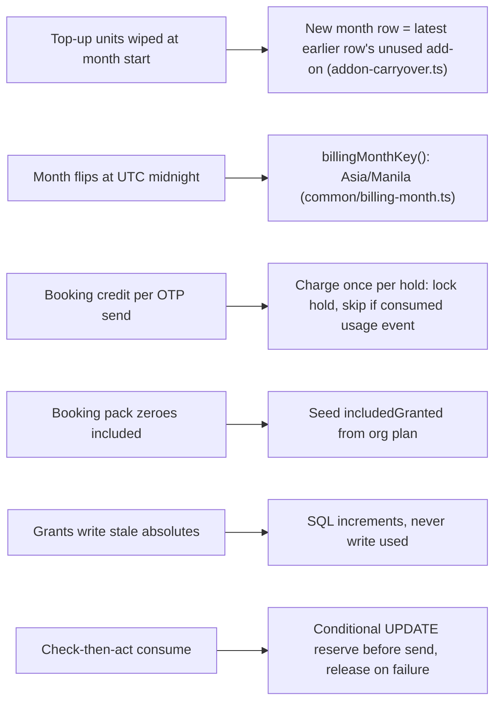

## Credit metering: carry-over, Manila month, once-per-hold booking charge, atomic reserve

TL;DR: Paid SMS and booking top-up units vanish at month rollover because every new
month ledger row is inserted with `addon: 0`; months flip at UTC midnight; a verified-booking
credit is charged on every OTP send; the booking ledger can be created with 0 included
units; grants overwrite counters with stale absolute values; and SMS/OTP consumption is
check-then-act. Fix: one shared Manila month helper, one shared carry-over helper used by
every ledger creator in my scope, SQL increments in grants, and an atomic conditional
reserve (`used + n <= included + addon`) before any send, released on failure.

### Flowchart (high-level)



### Task metadata

- Classification: `BUG_FIX` · `LARGE` · billing/metering (api) · HIGH (money: paid units, free usage). Lane: Deep.
- Docs loaded: `planning.md, plan-template.md`
- Backwards compatibility: `None` for public surfaces (no endpoint, DTO, response field, DB column, or enum touched). Internal Nest method change: `SmsMeteringService.canConsume`/`consume` replaced by `reserve`/`release`/`recordUsage`; only caller is `messaging/message-dispatch.service.ts:164,229,259` (grep across `apps/api/src`, non-spec). Behaviour change by design (Romeo's decisions): top-up units carry over; month boundary = Manila midnight; OTP resends on an already-charged hold are free.
- Migration: none.
- Deviation (declared): spec-file edits are specified by exact file, title, scenario and assertion instead of literal old/new blocks (mock-chain plumbing is mechanical); `src/` edits use literal new code with exact line ranges of the old code.
- Claims reversed while investigating: (a) "ledger creators are only the 4 listed files" — false: `platform-admin/platform-admin-billing.service.ts:1281-1290` (`reconcileManualIncludedBookingCredits`) also inserts `addonGranted: 0`, and `billing/billing.service.ts:957,995,1208,1244` insert `addon: 0`/`addonGranted: 0`. (b) "carry from previous month" — insufficient: an org with no row in M-1 would lose M-2 units; helper carries from the latest earlier row instead.
- Root cause: ledger inserts hard-code `addon: 0` (`messaging/sms-metering.service.ts:65-73`, `billing/sms-addon-grant.service.ts:160-168`, `billing/verified-booking-addon-grant.service.ts:158-166`, `intake/intake-booking.service.ts:687-699`); month keys from `getUTC*` (`sms-metering.service.ts:13-18`, `sms-addon-grant.service.ts:172-174`, `verified-booking-addon-grant.service.ts:170-172`, `intake-booking.service.ts:703-705,947-949`, `platform-admin-billing.service.ts:1858-1860`); OTP charge on every non-reused send (`intake-booking.service.ts:446-466`); booking ledger seeded `includedGranted: 0, sourcePlan: "free"` (`verified-booking-addon-grant.service.ts:158-165`); absolute writes `addon: ledgerAfter.addon, used: ledger.used` (`sms-addon-grant.service.ts:76-88`, `verified-booking-addon-grant.service.ts:75-87`); read-then-write `used: creditLedger.used + 1` (`intake-booking.service.ts:446-457`) and `canConsume`→send→`consume` (`message-dispatch.service.ts:164-172,229`, `sms-metering.service.ts:89-137`).
- Detected running model: Opus 5.5 (`claude-opus-5-5`).
- Recommended model: Opus 5.5, medium, every phase (identical pair → no switch stops). Confidence high. Fallback: Opus 5.5 high.
- Branch: `fix/no-ticket-credit-metering-v2` = `origin/main` (d59600c) + merge of `origin/fix/no-ticket-ls-sms-included-allowance` (PR #12, unmerged). Already set up in worktree `elegant-meninsky-449ad5` (session-provided worktree; parent brief dictates this base instead of `scripts/new-task-worktree.sh`).
- Release path: one PR into `main`, merge commit. Merging deploys production. PR #12 must merge first (or this PR carries its commits).
- Required skills: graphify, code review (ecc:code-review).

### Verified facts the design rests on

- Unique `(organization_id, month)` on `sms_credits` and `verified_online_booking_credits` (`packages/database/src/schema/index.ts:1008`, `:1111-1115`). `month` is `text` `YYYY-MM` → lexicographic order = chronological.
- `verified_online_booking_usage_events` has `booking_hold_id` index (`schema/index.ts:1141`) and `status text default 'consumed'` (`:1133`). Only other reader: `platform-admin-billing.service.ts:304-306` (list by org, no status filter) → a new `"released"` status value is display-only there.
- Existing unused-add-on rule: `billing.service.ts:802-804` `addonUsed = max(0, used - included); unused = max(0, addon - addonUsed)` → carry-over reuses the exact same rule (included consumed first).
- Both SMS providers catch internally (`providers/semaphore-sms.provider.ts`, `providers/twilio-sms.provider.ts` try/catch, return `{ok:false}`); `OtpFailoverService.sendOtp` (`intake/otp/otp-failover.service.ts:16-41`) can throw via `settings.getProvider`/`switchToSemaphore` DB calls → OTP path needs try/catch release; SMS path releases on the `ok:false` branches.
- Drizzle 0.45.1 (`node_modules/drizzle-orm/package.json`); `.for("update")` already used in repo (`businesses/businesses.service.ts:35`). `intake-booking.service.ts:238,584` already uses `db.transaction`.
- Production runtime is Bun (`apps/api/Dockerfile:4,54`). Manila month uses a fixed +8h shift (Asia/Manila is UTC+08:00 with no DST in IANA tzdata since 1978), so no ICU/timezone-data dependency in either Bun or vitest/node.

### Carry-over: source and why it cannot double-count

- Source: when (and only when) a creator finds no row for `(org, M)`, it reads the single latest row with `month < M` for that org (`ORDER BY month DESC LIMIT 1`, explicit columns `included/addon/used`) and inserts `addon = max(0, addon - max(0, used - included))` of that row.
- No double count: (1) the read runs only on the insert path; the unique `(org, month)` constraint allows one row per month, so a source row's leftover is copied at most into the first row created after it; after that, the new row is the latest earlier row for any later month. (2) Carried units become part of M's `addon`; M-1's row is never read again for carry. (3) Included units are not carried (only add-on).
- Loss-only edge (never gain): a usage `release` landing on M-1 after M's row was created returns the unit to the closed month, not M. Window = one in-flight send across Manila midnight. Accepted; listed as residual.

### Phase 1 — RED (Opus 5.5, medium)

Write tests below, `bun run tdd:red`, commit `test(billing): cover credit carry-over, Manila month, atomic reserve`. Existing tests whose assertions change get a prefix and move into order.

1. New `apps/api/src/common/billing-month.spec.ts` (module missing → valid RED):
   - `edge: rolls to the next month at Asia/Manila midnight` — `billingMonthKey(new Date("2026-10-31T16:00:00Z"))` → `"2026-11"`.
   - `edge: keeps the current month one second before Manila midnight` — `"2026-10-31T15:59:59Z"` → `"2026-10"`.
   - `edge: rolls the year at Manila midnight on Dec 31` — `"2026-12-31T16:00:00Z"` → `"2027-01"`.
2. New `apps/api/src/billing/addon-carryover.spec.ts` (module missing):
   - `error: carries nothing when usage exceeded included plus add-on` — `unusedAddonUnits({included:10,addon:5,used:20})` → 0.
   - `edge: carries all add-on units when usage stayed within included` — `{10,5,3}` → 5.
   - `edge: carries nothing when the org has no earlier ledger row` — `smsAddonCarryover` with select mock returning `[]` → 0.
   - `regression: carries unused add-on units from the latest earlier sms ledger row` — mock row `{included:300,addon:100,used:350}` → 50; assert `orderBy` and `limit(1)` called.
   - `regression: carries unused add-on units from the latest earlier booking ledger row` — `verifiedBookingAddonCarryover`, row aliased `{included:30,addon:25,used:40}` → 15.
3. `apps/api/src/billing/sms-addon-grant.service.spec.ts` (harness gains `orderBy` in select chain + `returning` on update; prior-row fixture):
   - `regression: new month ledger starts with unused add-on units from the latest earlier row` — no current row, prior row `{included:300,addon:100,used:350}`, grant 25 → inserted `smsCredits.addon === 50`.
   - `regression: grant increments addon in SQL and never writes used` — captured `set()` arg has no `used` key and `addon` is a drizzle `SQL` object (`instanceof SQL`).
   - `edge: ledger month follows Asia/Manila time` — `vi.setSystemTime("2026-10-31T16:30:00Z")`, no current row → inserted `month === "2026-11"`.
4. `apps/api/src/billing/verified-booking-addon-grant.service.spec.ts` (same harness changes + `organizations` select):
   - `regression: first booking pack of the month seeds included bookings from the org plan` — org `currentPlan: "starter"` → inserted `includedGranted === 30`, `sourcePlan === "starter"`.
   - `regression: new month booking ledger carries unused add-on units` — prior `{includedGranted:30,addonGranted:25,used:40}` → inserted `addonGranted === 15`.
   - `regression: grant increments addonGranted in SQL and never writes used`.
5. New `apps/api/src/messaging/sms-metering.service.spec.ts` (`reserve`/`release`/`recordUsage` missing → RED):
   - `error: reserve refuses when the conditional increment matches no row` — update `.returning()` → `[]` → `{allowed:false, reason:"sms_cap_reached"}`.
   - `error: reserve refuses with the paused reason without touching used` — existing row with a non-`none` `pausedReason` (value taken from `smsPausedReasonEnum` at execution) → not allowed, `update` not called.
   - `edge: new month credits start with carried add-on units` — no current row, prior row → inserted `addon` = carry; returned `total` = included + carry.
   - `regression: reserve increments used atomically and returns the reserved month` — `set().used` is `SQL`; result `{allowed:true, month:"2026-11"}` at fake time `2026-10-31T16:30Z`.
   - `happy: release gives units back to the reserved month` — update called, where uses passed month.
   - `happy: recordUsage writes the usage event without changing the ledger` — insert `smsUsageEvents` once, `update` not called.
6. `apps/api/src/messaging/message-dispatch.service.spec.ts` (mock `smsMetering = { reserve, release, recordUsage }`; existing tests at :146,:163,:180,:210,:293 renamed with prefixes, assertions `canConsume`→`reserve`, `consume`→`recordUsage`):
   - `error: skips with the reservation reason when sms credits cannot be reserved` (was :163).
   - `regression: releases reserved sms units when the provider send fails` (was :210) — `release("org-1","2026-11",2)`, `recordUsage` not called.
   - `regression: releases reserved sms units when the single retry also fails` — new.
   - `happy: reserves calculated segments before sending` (was :146), `happy: records usage once after a successful send` (was :180), `happy: retries safe transient failures once and records usage once` (was :293).
7. `apps/api/src/intake/intake-booking.service.spec.ts` (transaction mock tx gains `for`, `orderBy`, `returning` chain pieces):
   - `error: blocks public OTP sends when the atomic reserve matches no row` (was :311) — tx update `.returning()` → `[]` → `OTP_BILLING_BLOCKED`, `sendOtp` not called.
   - `error: releases the booking credit when the OTP provider fails` — `sendOtp` → `{ok:false}` → release transaction (`set().used` is `SQL`) and usage event `status: "released"`.
   - `error: releases the booking credit when the OTP send throws` — `sendOtp` rejects → release, error rethrown.
   - `regression: does not charge again when the hold already has a consumed usage event` — usage-event select returns `[{id:"ue-1"}]` → no credit update, no usage insert, OTP still sent.
   - `edge: creates the month ledger under the Asia/Manila month with carried add-on units`.
   - `happy: charges one credit and records provider details on first successful send` (was :188).
8. `apps/api/src/platform-admin/platform-admin-billing.service.spec.ts`:
   - `regression: manual subscription booking ledger carries unused add-on units into a new month` — no row for coverage month, prior row → inserted `addonGranted` = carry.

Done: `bun run tdd:red` exit 0, failing titles recorded.

### Phase 2 — shared helpers (Opus 5.5, medium)

1. New `apps/api/src/common/billing-month.ts`:
```ts
// Billing months follow Asia/Manila local time (UTC+08:00, no DST), so the month flips at Manila midnight.
const MANILA_OFFSET_MS = 8 * 60 * 60 * 1000;

export function billingMonthKey(date: Date = new Date()): string {
  const manila = new Date(date.getTime() + MANILA_OFFSET_MS);
  return `${manila.getUTCFullYear()}-${String(manila.getUTCMonth() + 1).padStart(2, "0")}`;
}
```
2. New `apps/api/src/billing/addon-carryover.ts` (reuse scan: `billing.service.ts:802-804` has the rule inline in a private method of a file I may not edit; no exported helper exists):
```ts
import { getDb, smsCredits, verifiedOnlineBookingCredits } from "@suki/database";
import { and, desc, eq, lt } from "drizzle-orm";

type SelectTx = { select: ReturnType<typeof getDb>["select"] };

// Included units are spent before paid add-on units (same rule as add-on refunds).
export function unusedAddonUnits(ledger: { included: number; addon: number; used: number }): number {
  return Math.max(0, ledger.addon - Math.max(0, ledger.used - ledger.included));
}

// Paid add-on units never expire: a new month row starts with what the latest earlier row left unused.
export async function smsAddonCarryover(tx: SelectTx, organizationId: string, month: string): Promise<number> {
  const [previous] = await tx
    .select({ included: smsCredits.included, addon: smsCredits.addon, used: smsCredits.used })
    .from(smsCredits)
    .where(and(eq(smsCredits.organizationId, organizationId), lt(smsCredits.month, month)))
    .orderBy(desc(smsCredits.month))
    .limit(1);
  return previous ? unusedAddonUnits(previous) : 0;
}

export async function verifiedBookingAddonCarryover(tx: SelectTx, organizationId: string, month: string): Promise<number> {
  const [previous] = await tx
    .select({
      included: verifiedOnlineBookingCredits.includedGranted,
      addon: verifiedOnlineBookingCredits.addonGranted,
      used: verifiedOnlineBookingCredits.used,
    })
    .from(verifiedOnlineBookingCredits)
    .where(and(eq(verifiedOnlineBookingCredits.organizationId, organizationId), lt(verifiedOnlineBookingCredits.month, month)))
    .orderBy(desc(verifiedOnlineBookingCredits.month))
    .limit(1);
  return previous ? unusedAddonUnits(previous) : 0;
}
```
Done: specs 1-2 green.

### Phase 3 — grant services, items 1/2/4/5 (Opus 5.5, medium)

1. `billing/sms-addon-grant.service.ts`:
   - imports: `import { and, eq, sql } from "drizzle-orm";` + `import { billingMonthKey } from "../common/billing-month";` + `import { smsAddonCarryover } from "./addon-carryover";`.
   - lines 71-88 Old (`const ledgerAfter = {...ledger, addon: ledger.addon + input.units}; await tx.update(smsCredits).set({ addon: ledgerAfter.addon, used: ledger.used, updatedAt }).where(...)`) → New:
```ts
    const [updated] = await tx
      .update(smsCredits)
      .set({ addon: sql`${smsCredits.addon} + ${input.units}`, updatedAt: new Date() })
      .where(
        and(
          eq(smsCredits.organizationId, input.organizationId),
          eq(smsCredits.month, ledger.month),
        ),
      )
      .returning({ included: smsCredits.included, addon: smsCredits.addon, used: smsCredits.used });
    const ledgerAfter = { ...ledger, ...updated };
```
     Reconciliation event (:99-119): "before" fields keep `ledger.*`; `includedAfter: ledgerAfter.included`, `addonAfter: ledgerAfter.addon`, `usedAfter: ledgerAfter.used`.
   - lines 160-168: `addon: 0` → `addon: await smsAddonCarryover(tx, organizationId, month)`.
   - line 132 `this.currentMonthKey()` → `billingMonthKey()`; delete `currentMonthKey` (172-174).
2. `billing/verified-booking-addon-grant.service.ts`: same three changes (`addonGranted` column, `verifiedBookingAddonCarryover`), plus item 4 at 158-166:
```ts
    const [org] = await tx
      .select({ currentPlan: organizations.currentPlan })
      .from(organizations)
      .where(eq(organizations.id, organizationId))
      .limit(1);
    const sourcePlan = org?.currentPlan ?? "free";
    const ledger: VerifiedBookingLedger = {
      organizationId,
      month,
      includedGranted: getPlanCatalogEntry(sourcePlan).limits.verifiedOnlineBookingsPerMonth,
      addonGranted: await verifiedBookingAddonCarryover(tx, organizationId, month),
      used: 0,
      sourcePlan,
    };
```
   (pattern = PR #12 `sms-addon-grant.service.ts:155-163`; imports `organizations`, `getPlanCatalogEntry`.)
Done: specs 3-4 green.

### Phase 4 — SMS reserve, items 1/2/6 (Opus 5.5, medium)

1. `messaging/sms-metering.service.ts`: delete `currentMonth` (13-18); `const m = month ?? billingMonthKey();` (33); insert path (65-86) uses `const addon = await smsAddonCarryover(db, organizationId, m);` → `addon`, `total = included + addon`, `remaining = total`, `at100Pct: total <= 0`. Replace `canConsume` (89-104) and `consume` (106-137) with:
```ts
  async reserve(
    organizationId: string,
    units: number = 1,
  ): Promise<{ allowed: true; month: string } | { allowed: false; reason: string }> {
    const month = billingMonthKey();
    const credits = await this.getOrCreateCredits(organizationId, month);
    if (credits.pausedReason !== "none") {
      return {
        allowed: false,
        reason: credits.pausedReason === "cap_reached" ? "sms_cap_reached" : credits.pausedReason,
      };
    }
    // Conditional increment so concurrent sends cannot overdraw the month's pool.
    const [reserved] = await getDb()
      .update(smsCredits)
      .set({ used: sql`${smsCredits.used} + ${units}`, updatedAt: new Date() })
      .where(
        and(
          eq(smsCredits.organizationId, organizationId),
          eq(smsCredits.month, month),
          sql`${smsCredits.used} + ${units} <= ${smsCredits.included} + ${smsCredits.addon}`,
        ),
      )
      .returning({ id: smsCredits.id });
    return reserved ? { allowed: true, month } : { allowed: false, reason: "sms_cap_reached" };
  }

  async release(organizationId: string, month: string, units: number = 1): Promise<void> {
    await getDb()
      .update(smsCredits)
      .set({ used: sql`GREATEST(${smsCredits.used} - ${units}, 0)`, updatedAt: new Date() })
      .where(and(eq(smsCredits.organizationId, organizationId), eq(smsCredits.month, month)));
  }

  // Units were already taken by reserve(); this only records the usage event.
  async recordUsage(
    organizationId: string,
    businessId: string,
    messageEventId: string,
    units: number = 1,
    costMicros?: number,
  ): Promise<void> {
    await getDb().insert(smsUsageEvents).values({
      messageEventId,
      organizationId,
      businessId,
      units,
      status: "consumed",
      costMicros: costMicros ?? null,
    });
  }
```
2. `messaging/message-dispatch.service.ts`:
   - 163-172 → `let smsReservedMonth: string | null = null;` declared before `if (input.channel === "sms")`; body: `const reservation = await this.smsMetering.reserve(input.organizationId, meteringUnits); if (!reservation.allowed) { return this.recordSkipped({ ...input, rawMessage: body }, reservation.reason); } smsReservedMonth = reservation.month;`
   - 229 and 259: `this.smsMetering.consume(` → `this.smsMetering.recordUsage(`.
   - retry-failed branch (after `.where(eq(messageEvents.id, messageEventId));` at ~283) and final else branch (~310): add `if (smsReservedMonth) await this.smsMetering.release(input.organizationId, smsReservedMonth, meteringUnits);`.
Done: specs 5-6 green.

### Phase 5 — OTP once per hold, items 1/2/3/6 (Opus 5.5, medium)

`intake/intake-booking.service.ts`:
1. imports: `import { billingMonthKey } from "../common/billing-month";`, `import { verifiedBookingAddonCarryover } from "../billing/addon-carryover";`.
2. `ensureVerifiedBookingCredits(tx, organizationId, planType)` (664-701): takes `tx` (`{ select; insert }` typed like `BillingTx`) instead of `getDb()`; `month = billingMonthKey()`; `addonGranted: await verifiedBookingAddonCarryover(tx, organizationId, month)`. Delete `getCurrentMonthUtcKey` (703-705) and `toMonthKey` (947-949) (no other callers — grep).
3. Move `await this.assertOtpSendAllowed(...)` (403-408) to run before the credit step (rate limits identical; only order changes so a reservation is never taken for a rate-limited send).
4. Replace 393-406 (ledger read + exhausted check) with:
```ts
    const charge = await db.transaction(async (tx) => {
      // Row lock on the hold serialises concurrent sends so a hold is charged at most once.
      await tx.select({ id: bookingHolds.id }).from(bookingHolds).where(eq(bookingHolds.id, hold.id)).for("update");
      const [charged] = await tx
        .select({ id: verifiedOnlineBookingUsageEvents.id })
        .from(verifiedOnlineBookingUsageEvents)
        .where(and(
          eq(verifiedOnlineBookingUsageEvents.bookingHoldId, hold.id),
          eq(verifiedOnlineBookingUsageEvents.status, "consumed"),
        ))
        .limit(1);
      if (charged) return { status: "already_charged" as const };
      const ledger = await this.ensureVerifiedBookingCredits(tx, business.organizationId, state?.currentPlan ?? "free");
      const [reserved] = await tx
        .update(verifiedOnlineBookingCredits)
        .set({ used: sql`${verifiedOnlineBookingCredits.used} + 1`, updatedAt: new Date() })
        .where(and(
          eq(verifiedOnlineBookingCredits.organizationId, business.organizationId),
          eq(verifiedOnlineBookingCredits.month, ledger.month),
          sql`${verifiedOnlineBookingCredits.used} + 1 <= ${verifiedOnlineBookingCredits.includedGranted} + ${verifiedOnlineBookingCredits.addonGranted}`,
        ))
        .returning({ id: verifiedOnlineBookingCredits.id });
      if (!reserved) return { status: "exhausted" as const };
      const [usageEvent] = await tx
        .insert(verifiedOnlineBookingUsageEvents)
        .values({ organizationId: business.organizationId, businessId: hold.businessId, bookingHoldId: hold.id, units: 1, status: "consumed" })
        .returning({ id: verifiedOnlineBookingUsageEvents.id });
      return { status: "charged" as const, month: ledger.month, usageEventId: usageEvent!.id };
    });
    if (charge.status === "exhausted") { /* existing recordBlockedOtpSendEvent OTP_BILLING_BLOCKED + throw, unchanged */ }
```
5. Wrap `otpFailover.sendOtp` (416-419): `try { otpResult = await ... } catch (err) { await this.releaseBookingCharge(charge, business.organizationId); throw err; }`; in `!otpResult.ok` branch (421-435) call `await this.releaseBookingCharge(...)` before recording. New private method:
```ts
  private async releaseBookingCharge(
    charge: { status: "charged"; month: string; usageEventId: string } | { status: "already_charged" },
    organizationId: string,
  ) {
    if (charge.status !== "charged") return;
    await getDb().transaction(async (tx) => {
      await tx
        .update(verifiedOnlineBookingCredits)
        .set({ used: sql`GREATEST(${verifiedOnlineBookingCredits.used} - 1, 0)`, updatedAt: new Date() })
        .where(and(
          eq(verifiedOnlineBookingCredits.organizationId, organizationId),
          eq(verifiedOnlineBookingCredits.month, charge.month),
        ));
      await tx
        .update(verifiedOnlineBookingUsageEvents)
        .set({ status: "released" })
        .where(eq(verifiedOnlineBookingUsageEvents.id, charge.usageEventId));
    });
  }
```
6. Replace 446-466 (absolute `used: creditLedger.used + 1` update + usage insert) with: `if (charge.status === "charged") await db.update(verifiedOnlineBookingUsageEvents).set({ provider: this.toOtpAuditProvider(otpResult.provider), providerVerificationSid: otpResult.providerMessageId ?? null }).where(eq(verifiedOnlineBookingUsageEvents.id, charge.usageEventId));`
Done: spec 7 green.

### Phase 6 — platform-admin creator (Opus 5.5, medium)

`platform-admin/platform-admin-billing.service.ts`: `currentMonthKey` (1858-1860) body → `return billingMonthKey(date);` (keeps its 5 callers: 1265, 1762, 1776, 1793, 1821); insert at 1281-1290 `addonGranted: 0` → `addonGranted: await verifiedBookingAddonCarryover(tx, input.organizationId, month)`. Done: spec 8 green.

### Phase 7 — validate, graphify, PR (Opus 5.5, medium)

- Targeted: `cd apps/api && ../../node_modules/.bin/vitest run src/common/billing-month.spec.ts src/billing/addon-carryover.spec.ts src/billing/sms-addon-grant.service.spec.ts src/billing/verified-booking-addon-grant.service.spec.ts src/messaging/sms-metering.service.spec.ts src/messaging/message-dispatch.service.spec.ts src/intake/intake-booking.service.spec.ts src/platform-admin/platform-admin-billing.service.spec.ts`
- `bun run typecheck`, `bun run lint`, `CI=true bun run test`, `TDD_GATE_BASE=origin/main bun run tdd:gate`, `bun run build`.
- `graphify update .` (code-only change) → commit `graphify-out/`.
- Save this plan as `docs/plans/credit-metering.md` (first commit). Push, `gh auth switch --hostname github.com --user OwlRepo`, open PR into `main` (body notes it contains PR #12 commits until #12 merges).

### Test Matrix

| layer | required | file | cases |
|---|---|---|---|
| unit/integration vitest (guarded .ts) | required | specs 1-8 above | error > edge > regression > happy as listed |
| .tsx component | not required — no web change | — | — |
| endpoint/webhook integration | not required — no controller/DTO change; services tested with mocked DB | — | — |
| migration | not required — no migration | — | — |
| smoke | required | `bun run build` | build passes |

### Data impact

- New queries: one bounded `ORDER BY month DESC LIMIT 1` select per new month-row creation (once per org per month per table). OTP first send per hold: +1 lock select, +1 indexed usage-event select, +1 usage update on success (replaces read-then-write update + insert). Resend on charged hold: lock + usage select only. SMS: reserve replaces canConsume read + consume update (same count). All tenant-scoped by `organization_id`.
- Grants: one fewer written field; new values via `RETURNING` (no extra round-trip).

### Hand-off notes (files I may not edit)

- `billing/billing.service.ts` (sibling): replace `getCurrentMonthUtcKey`/`toMonthKey` (1346-1352; callers 919, 981, 1064, 1080, 1096, 1193, 1201, 1225, 1238) with `billingMonthKey` from `common/billing-month`. Ledger inserts at 957 (sms, `syncIncludedSmsCredits`), 995 (booking, `reconcileIncludedBookingCredits`), 1208, 1244 (`getOrCreate*Ledger`, refund path) insert `addon: 0`/`addonGranted: 0` → must use `smsAddonCarryover`/`verifiedBookingAddonCarryover`. **Item 1 is incomplete until this lands**: a subscription webhook (`syncIncludedMonthlyAllowances`, called at 731) that creates the month row first still zeroes carried units, and UTC vs Manila keys differ 00:00-08:00 Manila on the 1st, so billing.service can read/create a different row than metering. DECISION FOR PARENT: let me patch those lines in this PR, or sibling patches after this PR merges.
- Refund session: reuse `unusedAddonUnits` (`billing/addon-carryover.ts`) for `billing.service.ts:802-804`; refunds act on the current-month row whose `addon` already includes carried units.

### Non-blockers (not fixed)

- `messaging/email-metering.service.ts:12-16,94` UTC month and the same canConsume→consume race for email credits.
- `messaging/messaging.service.ts:73-77` uses server local time for AI message credits; `ai/ai-usage.service.ts:11`, `help/assistant-read-model.service.ts:71,269` UTC.
- Concurrent first-of-month row creation: plain `insert` without conflict handling throws `23505` in every creator (pre-existing).
- No `credit_reconciliation_events` row for the carried amount (audit trail).
- `message-dispatch.service.ts`: a DB exception between `reserve` and provider send (e.g. `messageEvents` insert) leaks the reservation (providers themselves never throw).

### Residual risks

- Deploy switch UTC→Manila: keys only differ 00:00-08:00 Manila on the 1st; deploying outside that window needs no data fix.
- Release after Manila midnight returns a unit to the closed month (loss of ≤ units of one in-flight send, never a gain).

### Addendum — grace-aware included plan (`getIncludedCreditsPlan`, from sub-sync PR)

- Verified: `getIncludedCreditsPlan` exists on no `origin/*` branch yet (`git grep` across all remote branches, 2026-11-16). So a local fallback would be a copy of logic I can't see. Choice: **rebase after the sub-sync PR merges**, no local fallback. Phases 1-7 do not depend on it; the PR opens only after the rebase plus Phase 8.
- Phase 8 (Opus 5.5, medium), after `git rebase origin/main` with the sub-sync PR merged:
  - `messaging/sms-metering.service.ts:34` (`this.planCapacity.getActivePlan(organizationId)` in `getOrCreateCredits`) → `getIncludedCreditsPlan`. Regression test in `sms-metering.service.spec.ts`: `regression: past_due org gets free included SMS but keeps carried add-on units`.
  - `messaging/email-metering.service.ts:31` → `getIncludedCreditsPlan`. Regression test in `email-metering.service.spec.ts`: `regression: past_due org gets free included email allowance`. (Scope added on parent's request.)
  - Item-4 booking seed (`verified-booking-addon-grant.service.ts` `getOrCreateLedger`) → `getIncludedCreditsPlan` instead of `organizations.currentPlan`. Needs `PlanCapacityService` injected into `VerifiedBookingAddonGrantService` (Nest-provided: `billing/billing.module.ts:15` already imports `PlanCapacityModule`). BLOCKER: `billing/billing.service.ts:66` builds a default `new VerifiedBookingAddonGrantService()` without arguments, and I may not edit that file. DECISION FOR PARENT: (a) sub-sync session changes that default to pass `planCapacity` (clean), or (b) I keep item 4 on `organizations.currentPlan` (the PR #12 pattern, not grace-aware) and note it.
  - Carried add-on units stay independent of grace (the carry helper ignores plan).
- Same-pattern seeds I touch but did not add, and leave unchanged unless the parent says otherwise: `intake-booking.service.ts` `ensureVerifiedBookingCredits` (plan from `OrgBillingStateService.currentPlan`), `sms-addon-grant.service.ts:155-163` (PR #12, `organizations.currentPlan`), `platform-admin-billing.service.ts:1265` (plan from manual payment).

### Approval record (parent session, 2026-11-16)

- Approved: Phases 1-7 now; Phase 8 after the sub-sync PR merges (rebase, then open the PR).
- Decision 2: `billing/billing.service.ts` is not touched. Month-row creators at :957, :995, :1208, :1244 and the UTC month at :1346 go to the follow-up refund session.
- Decision 3: option (b). Item 4 seeds from `organizations.currentPlan` (PR #12 pattern). Residual: the refund session switches it to the grace-aware plan when it changes `billing.service.ts:66`. Intake already blocks during past_due (`intake-booking.service.ts:379`).
- Residuals kept as-is: plan sizing in `ensureVerifiedBookingCredits`, `sms-addon-grant.service.ts:155-163`, `platform-admin-billing.service.ts:1265`; a release landing on the closed month across Manila midnight.

### Phase 8 addition — grace-aware seeding in grant services (parent request, 2026-11-17)

- Reachable without changing the BillingService constructor. Facts from `origin/fix/no-ticket-ls-subscription-sync-v2`:
  - `PlanCapacityService.getIncludedCreditsPlan` (`common/plan-capacity.service.ts:78-81`) returns `OrgBillingStateService.getOrgBillingState(orgId)?.includedCreditsPlan ?? "free"`.
  - `includedCreditsPlan: lemonPaymentFailing ? "free" : plan` (`common/org-billing-state.service.ts:156`).
  - `OrgBillingStateService` has no constructor dependencies (`org-billing-state.service.ts:45-47`). It is global-exported by `PlanCapacityModule` (`common/plan-capacity.module.ts:7-21`).
- Change: `SmsAddonGrantService` and `VerifiedBookingAddonGrantService` each get `constructor(private readonly orgBillingState: OrgBillingStateService = new OrgBillingStateService()) {}`. This is the same default-instance pattern as `IntakeBookingService` (`intake-booking.service.ts:75-79`).
  - Nest injects the global provider.
  - `billing.service.ts:65-66` (`new SmsAddonGrantService()` / `new VerifiedBookingAddonGrantService()`) keeps compiling and gets the default instance. No edit to billing.service.ts.
- In each `getOrCreateLedger` insert path, the `organizations.currentPlan` select is replaced by `(await this.orgBillingState.getOrgBillingState(organizationId))?.includedCreditsPlan ?? "free"`. That drives SMS `included` (`SMS_INCLUDED_BY_PLAN`) and booking `includedGranted` / `sourcePlan`. Carry-over stays plan-independent.
- Caveat: `getOrgBillingState` reads through `getDb()`, outside the grant transaction. It only reads plan state, never ledger counters, so there is no double-count risk.
- Tests (RED first):
  - `sms-addon-grant.service.spec.ts`: `regression: a grant during payment grace seeds the free included allowance but keeps the pack units`.
  - `verified-booking-addon-grant.service.spec.ts`: `regression: a booking pack bought during payment grace seeds free included bookings`.
  - Both spec harnesses pass a stub `orgBillingState` instead of the `organizations` select.
- Still hand-off (refund session, billing.service.ts): `getOrCreateSmsLedger` / `getOrCreateVerifiedBookingLedger` (:1180-1244) seed from the paid plan during grace.
