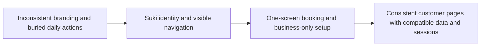

# Suki redesign and repository-wide rename

Approved by Romeo on 2026-11-16. Docs loaded: planning.md, plan-template.md.

## Summary and scope

Rename application branding and internal code from Tyvera to Suki. Application URLs use `suki.tyvera.app`; Tyvera remains the parent domain. Redesign all 11 rendered signed-in customer pages and onboarding. Public and platform-admin pages receive branding corrections only. Preserve the four retired-route redirects.

Worktree: `.claude/worktrees/feat-customer-experience-review`; branch: `feat/no-ticket-customer-experience-review`. Fetched origin/main and verified both HEAD and upstream equal `642e175ebbc7de4ae62f5c9a4b0b1256e1d5427e` before implementation. The primary checkout remains untouched. All phases retain the current Codex model and reasoning setting; exact runtime variant/effort is not exposed.

## Compatibility contract

- No new API endpoints, dependency, database schema, or infrastructure migration.
- Preserve routes/query parameters, redirects, exported interfaces through aliases, authentication/tenant guards, payment permissions, availability/validation, cancellation confirmation, and automation/messaging behavior.
- Rename workspace packages/imports/build filters/lockfile together. Preserve legacy exports where consumers may depend on them.
- Prefer canonical Suki config/storage/cookie names with legacy fallback. Keep legacy sessions/preferences readable; do not delete historical data. Host changes can require sign-in because browsers scope cookies by host.
- Application URLs become `suki.tyvera.app`; production database names, stored identifiers (`auto_tyvera`), server/backup directories, registry addresses, historical migrations, and deployed external callbacks retain compatibility. No production cutover in this task.
- Generate agent definitions from edited sources, not by editing generated definitions.
- Audit remaining case-insensitive Tyvera references and explain each retained category.

## Phase 1: RED

Tests first, title order `error:` > `edge:` > `regression:` > `happy:`. Run `bun run tdd:red`, observe expected failures, commit tests separately. Cover session/config/storage compatibility, expanded sidebar and nav, booking's one-screen/direct-entry behavior, business-only onboarding and historical timestamps. Existing changed expectations must be explained as intentional requirement changes, not silently weakened.

## Phase 2: rename

Rename application copy, page titles, accessibility labels, assistant identity, docs/examples/tests/fixtures, packages, imports, build references and lockfile. Rename Tyvera-specific files/symbols with compatibility aliases. Canonical Suki configuration takes precedence over old values. Preserve existing infrastructure identifiers and parent-domain references. Scan all tracked text, including generated definitions after regeneration; historical SQL/snapshots remain unchanged.

## Phase 3: shared foundation and daily workflows

- Sidebar expanded unless an explicit existing preference says otherwise. Direct labeled links: Today, Appointments, Needs attention, Share slots, Business summary, Plan & usage, Import customers, Settings, Help. Preserve plan-gated analytics and attention counts.
- Mobile bottom navigation: Today, Appointments, Attention, More; More contains all destinations. 375px, visible focus, labeled controls, no horizontal page overflow.
- Reuse existing UI primitives and blue tokens. One page title and concise contextual instruction, consistent spacing/loading/feedback.
- Dashboard becomes Today: actual day agenda and actionable reminders first, Arrived/Reschedule on records, QR/link/month metrics/activity below. Never present month data as daily metrics.
- Appointments: agenda first, calendar accessible; one form with existing/new customer modes, validated contact, available date/time, notes. Keep existing resolve-for-booking and appointment APIs, availability retry, duplicate-submit protection, rescheduling prefill, cancellation confirmation, and saved-but-refresh-failed handling.
- Global New appointment links to `/appointments?new=1`; close consumes only `new`, preserving other parameters.
- Attention retains resolution/sending rules. Share slots puts Copy booking link first while preserving templates/backgrounds/assets.

## Phase 4: remaining pages and onboarding

- Reports link summary and plan-gated usage analytics; preserve metric definitions and month selection.
- Billing title Plan & usage; current plan, allowances, contextual actions, request history. Human-readable status labels; preserve owner/member, readonly, checkout/manual mode, cancellation and scheduled changes.
- Settings/setup use purpose-based sections, direct access and existing saves. Import source selection adjacent to inputs; preview/confirm/sample/rollback remain. Help uses task-based destination links and keeps English/Tagalog.
- Business name/type unlock workspace. First booking and sharing are optional. No mandatory sample customer or fabricated visit. Keep completed users complete and unlock existing businesses with partial legacy onboarding. Keep existing completion sentinel/progress endpoints, completed-step history and timestamps. On save failures retain inputs and offer Retry.

## Test matrix and validation

| Layer | Required | Scenarios |
|---|---|---|
| Web components/hooks | Yes | loading, empty, errors, readonly, keyboard, navigation, branding, storage/config fallback, booking flows, onboarding progression |
| API integration | Yes for session compatibility | canonical and legacy cookie behavior, canonical precedence, logout, unchanged auth guard |
| Package/build integration | Yes | package imports, lockfile, aliases, generated definitions |
| Database migration | Not required | no schema change; historical SQL untouched |
| Browser/manual | Yes | all rendered customer routes at 375px and desktop, owner/member/all-plan UI variants, real local data only |

Run targeted workspace vitest first, then full tests, typecheck, lint, build, agents:lint, check:assistant-context-governance, and TDD CI gate against upstream. Compare failures with baseline and name pre-existing failures. Update relevant assistant knowledge and AI maps; run Graphify incremental maintenance after final indexed edits and report graph diff/token evidence. Review complete diff and prepare one PR to main; no merge/deploy.

Acceptance: one click to each major desktop destination; one click to open booking; no intermediate booking wizard screens; Arrived in one action; no horizontal page overflow at 375px. Preserve payment/session/data safety.

## Scans and closeout

Reuse existing services, hooks, forms, primitives, and API contracts. No new framework or speculative abstraction. Keep data scoped by existing business/organization queries; no new DB round trips required by the rename. Daily dashboard can reuse the existing appointment API. Cleanup only task-owned resources no longer needed; retain local stack while review is active.

Implementation must be verified before completion is claimed. Production host availability and external callback registrations remain unverified and are outside this local implementation's release authority.
