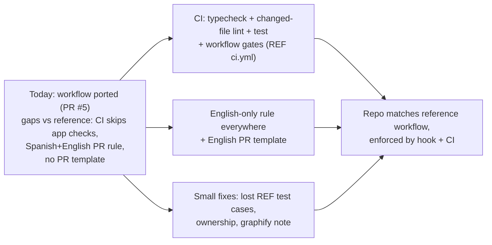

## Workflow port: close the remaining gaps (English-only)

Revision 2, after your feedback:
- Codex work is dropped.
- `tarraula-command-center` (REF) is the source of truth. Where this repo diverges from it, the reference wins, unless the stack forces a substitution.
- The Spanish translation is dropped. Everything is English only.

TL;DR: PR #5 (merged 2026-10-01, `63be5b7`) already ported almost all of REF's workflow into Tyvera. That covers routing, planning, approval, worktrees, the TDD hook, the CI TDD gate, personas, the `.ai-engineering/` layer and the graphify rule. This plan closes what is still missing against REF:
- CI runs typecheck, changed-file lint and tests, like REF's `ci.yml`.
- A permanent English-only rule is written into the repo.
- REF's PR template is ported, in English.
- Two lost REF test cases come back.
- A few small ownership and graphify-doc holes get closed.

### Flowchart (high-level)



### Task metadata

- Classification: `INFRASTRUCTURE` · `MEDIUM` · AI workflow / CI / docs · risk: low (no `apps/*/src` runtime code; CI gets stricter).
- Docs loaded: `planning.md, plan-template.md`
- Backwards compatibility: `Additive`. No endpoint, schema or exported runtime symbol is touched. Only behaviour change: PR CI now also fails on typecheck, changed-file lint or test failures.
- Claims reversed while investigating:
  - "HERE generator has `renderCodexToml`." Disproved: that grep output came from REF.
  - "REF's `TDD_GATE_HEAD_REF` skip is a lost hardening." Disproved: HERE removed it on purpose because it let a fork PR named `main` skip the gate. Regression test at `scripts/ci/tdd-gate.test.mjs:90`. This is the one place HERE stays stricter than REF, since it is a security fix.
- Detected running model: `claude-opus-5-5`.
- Recommended model for all phases: Opus, high reasoning; confidence high. Fallback: Sonnet, high. Every phase uses the same pair, so execution runs straight through.
- Branch: `infra/no-ticket-workflow-gap-close`, from `origin/main`.
- Release path: one PR into `main`, merge commit. Merging deploys production and is your call. REF's dev → stg → main flow is not ported because this remote has only `main` plus task branches, and `deploy.yml` deploys on push to `main`.
- Execution preflight:
  1. `git fetch origin`
  2. `scripts/new-task-worktree.sh infra workflow-gap-close`
  3. `bun install --frozen-lockfile`

### Gap matrix (REF artifact → here)

| REF artifact | Exists here? | Action | Stack substitution |
|---|---|---|---|
| `AGENTS.md` core (principles, A–Z flow + node rules, routing, persona, caveman) | yes (PR #5) | adapt: add "English only" line | persona line fits Next/NestJS/Drizzle/Docker |
| `CLAUDE.md` (`@AGENTS.md` + facts) | yes | adapt: "Tests"/CI line, English-only convention | bun, turbo, vitest, single `main` |
| `AI_WORKFLOW.md`, `PLANNING_STANDARDS.md` stubs | yes | keep | — |
| `docs/ai/*` (17 docs, contracts, file-index, 4 prompts) | yes | merge: English-only `pr-evidence.md`; REF graphify-hook line in `planning.md`; CI line in `testing-strategy.md` | — |
| `docs/ai/cron-simtest-guide.md` | no | skip: Tarraula cron sim | — |
| `.ai-engineering/**` | yes | keep; autonomy Level 2 = REF. Verify the PILOT_FROZEN state record in Phase 0 | — |
| `AUTONOMOUS_ENGINEERING_BOOTSTRAP.md` | no (installer spec, already applied by PR #5) | skip as a file | — |
| `agents/src` → generator → `.claude/agents/*.md`, `agents:generate`/`agents:lint` | yes, 9 personas, lint clean | adapt: ownership holes only | `database-architect`, `nestjs-api-dev` replace REF's supabase-architect and be-agent |
| `.codex/agents/*.toml` | no | **skip, per your call** | — |
| `.claude/settings.json` PreToolUse hook → `tdd-red-guard.mjs` (+ test) | yes, same matcher | keep | — |
| `scripts/ci/{tdd-lib,tdd-red,tdd-gate,tdd-runner,test-repo}.mjs` + tests | yes, 81/81 pass; REF hardening present | merge: restore 2 lost REF test cases | vitest per workspace + `node:test` |
| `scripts/ci/verified-tree.mjs` + test | no | skip: needs a persistent self-hosted-runner dir (`/var/lib/tarraula-ci`) and promotion PRs. HERE runs on ephemeral `ubuntu-latest` with one `main` | — |
| `.github/workflows/ci.yml` steps | partial | **merge**: add REF's typecheck, changed-file lint and test steps | bun/turbo; REF sim/provider/migration-lint steps have no HERE equivalent and are skipped |
| `.github/PULL_REQUEST_TEMPLATE.md` | no | create, English-only | — |
| `scripts/git-hooks/pre-commit` | equivalent `.husky/pre-commit` | keep | husky |
| `scripts/new-task-worktree.sh` + `.claude/worktrees/` gitignored | yes | keep | — |
| Graphify node K + plan/closeout gate | yes; `graphify` installed | merge: REF line "`graphify hook install` supplements this gate but never replaces it" | — |
| `scripts/graphify/*.py` | no | skip: REF's own docs/gate never call them (one-off PR #1227); they are Supabase/i18n/single-app specific | — |

### Phase 0 — Setup + baseline (Opus, high)

1. Run the preflight.
2. Save this plan to `docs/plans/infra-workflow-gap-close.md` and commit it first.
3. Run baselines and record the output: `bun run typecheck`, `bun run lint`, `CI=true bun run test`, `bun run test:scripts`, `bun run agents:lint`.
4. `grep -rn PILOT_FROZEN .ai-engineering`. If the state record is missing, add it to `.ai-engineering/SETUP.md` (state `PILOT_FROZEN`, Level 2, no merge).

Done: baselines recorded.

### Phase 1 — Restore lost REF test cases (Opus, high)

1. `scripts/ci/tdd-red.test.mjs`: port REF's `edge:` case "an optional route folder `[[...slug]]` is also found" (REF `scripts/ci/tdd-red.test.mjs:80`), translated to English, with an `apps/web/src/app/[[...slug]]/` fixture.
2. `scripts/ci/tdd-lib.test.mjs`: restore REF's two `globSafe` assertions (REF :235, :245) for `[[...slug]]` and multi-bracket `[assetId]/[callId]`, replacing HERE's merged single case (:266).

These tests cover behaviour that already exists, so they are `regression:` coverage and pass on first run. No logic changes, so `tdd:red` is not needed. If one fails, that is a real bug: stop and do an RCA.

Done: `bun run test:scripts` passes with 83 or more tests.

### Phase 2 — Ownership + graphify doc (Opus, high)

1. `agents/src/nextjs-frontend-dev.agent.mjs` `ownedGlobs`: add `apps/web/src/proxy.ts` (the auth/route middleware, currently unowned).
2. `agents/src/database-architect.agent.mjs` `ownedGlobs`: add `packages/database/src/*.ts` (`database.ts`, `index.ts`; no overlap with `src/schema/**`).
3. `bun run agents:generate`, then `bun run agents:lint`.
4. `docs/ai/planning.md`: after line 108 (the "Every implementation plan ends with a Graphify maintenance step…" paragraph), add the sentence "`graphify hook install` supplements this gate but never replaces it."

Done: lint passes, 9 personas, no glob conflicts.

### Phase 3 — CI app gates, per REF `ci.yml` (Opus, high)

1. `.github/workflows/ci.yml`: after the "TDD gate" step, add these steps in REF order (REF :59-74):
   ```yaml
      - name: Typecheck
        run: bun run typecheck

      - name: Lint changed files
        env:
          BASE_REF: ${{ github.base_ref }}
        run: |
          files="$(git diff --name-only --diff-filter=ACMR "origin/${BASE_REF}...HEAD" -- '*.ts' '*.tsx' '*.js' '*.jsx' '*.mjs')"
          if [ -n "$files" ]; then
            bunx eslint $files
          else
            echo "No lintable files changed - skipping lint."
          fi

      - name: Unit tests
        env:
          CI: "true"
        run: bun run test
   ```
   The root `eslint.config.mjs` exists. Phase 0 confirms whether a root `bunx eslint <file>` resolves workspace configs. If it doesn't, fall back to `bun run lint` (turbo, full) when that baseline is green.
2. If the typecheck or test baseline is red on `main`: stop and report (stop condition Z). Fixing unrelated failures is out of scope.
3. `packages/types/package.json`: add `"test": "vitest"`, matching web and api, so turbo `test` runs `packages/types/src/mobile.spec.ts`. Do this only if `vitest` already resolves for that workspace; adding a new dependency needs asking first.
4. `docs/ai/testing-strategy.md` and the `CLAUDE.md` "Tests" bullet: add "CI (`.github/workflows/ci.yml`) runs `tdd:gate`, `typecheck`, changed-file lint, `test`, `test:scripts`, and `agents:lint` when persona files change."

Done: every new step passes locally (`CI=true`).

### Phase 4 — English only (Opus, high)

1. `docs/ai/pr-evidence.md:53-66`.
   - Old: "Title and summary are written in plain language for a non-technical reviewer, in Spanish AND English. No `Co-Authored-By` Claude trailer." plus the `## Resumen (Español)` / `## Summary (English)` / `## Qué cambia / What changes` / `## Cómo probar / How to test` headings.
   - New: "Title and summary are written in plain English for a non-technical reviewer. No `Co-Authored-By` Claude trailer." with headings `## Summary`, `## What changes`, `## How to test`. The rest of the block is unchanged.
2. Make the rule permanent:
   - `CLAUDE.md` "Conventions": add "All repository text — code comments, docs, commit messages, PR titles and bodies — is written in English only."
   - `AGENTS.md` "Core principles" principle 5 area: add a one-line pointer to that convention, so Codex and subagents see it.
3. Create `.github/PULL_REQUEST_TEMPLATE.md`, English-only and adapted from REF's template:
   - Summary, What changes, How to test.
   - Change Type, Evidence, Testing.
   - TDD evidence: Test Matrix, RED output, and waiver lines `TDD-Waiver:` / `Migration-Waiver:`, since `tdd:gate` reads `PR_BODY`.
   - A gates checklist noting what CI already checks.
4. Run `grep -rniE 'spanish|español|resumen|qué|cómo'` over `AGENTS.md CLAUDE.md docs/ai .ai-engineering .github agents`. Expected: no hits.

### Validation and acceptance

**Test matrix**

| Layer | Required? | File | Cases |
|---|---|---|---|
| script unit tests | required | `scripts/ci/tdd-red.test.mjs`, `scripts/ci/tdd-lib.test.mjs` | `edge:` `[[...slug]]` found; `regression:` multi-bracket globSafe |
| web/api/types vitest | not required: no `src` change | — | — |
| e2e | not required: no UI | — | — |

**Commands, with real output pasted**
- `bun run agents:generate`, then `bun run agents:lint`: clean.
- `bun run test:scripts`: all pass.
- TDD hook proof, run in the task worktree; nothing is committed:
  1. Pipe `{"tool_name":"Edit","tool_input":{"file_path":"<wt>/apps/api/src/app.module.ts"}}` into `node scripts/hooks/tdd-red-guard.mjs`. Expect a block.
  2. Add a throwaway failing `apps/api/src/__demo__.spec.ts` and run `bun run tdd:red`.
  3. Pipe the same input again. Expect it to be allowed.
  4. Delete the demo spec and the marker.
- `bun run typecheck`, the changed-file lint, `CI=true bun run test`: green.
- Dangling-path scan: every backticked repo path in `AGENTS.md`, `CLAUDE.md`, `docs/ai/**`, `.ai-engineering/**` resolves. Known non-dangling:
  - `.ai-engineering/` relative paths.
  - `packages/database/tests/`, documented as "no harness yet".
  - Generic `src/` mentions.
- Graphify gate: load the `graphify` skill, run `/graphify . --update` after the last edit (the graph is 2 commits stale today), and report the graph diff and token cost.

### Compatibility, docs, and scans

- Public surfaces: none touched.
- Docs updated in the same PR: `AGENTS.md`, `CLAUDE.md`, `docs/ai/{pr-evidence,planning,testing-strategy}.md`, plus the new `.github/PULL_REQUEST_TEMPLATE.md`.
- Optimization scan: verified-tree caching is not worth it on ephemeral runners.
- Data impact: none.

### Handoff

- Read `docs/ai/handoff.md`, then commit only on `infra/no-ticket-workflow-gap-close`.
- Run `gh auth switch --hostname github.com --user OwlRepo`, then `gh pr create --base main`.
- Title and body in plain English, with no Co-Authored-By trailer in the PR body.
- Merging is your call.
- Final report: what works, what's left, residual risks:
  - CI time goes up.
  - `packages/database` has no migration-test harness, so migrations rely on `Migration-Waiver:`.
  - The hook is Claude-only; Codex sessions rely on the CI gate.

### Rollback

Revert the PR merge commit. Every change is docs, CI, test scripts or generated persona files. No data or runtime is affected.
