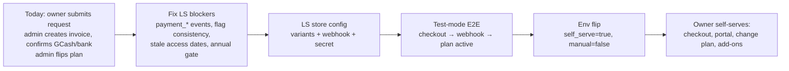

## Replace manual billing with Lemon Squeezy self-serve

TL;DR: Lemon Squeezy (LS) checkout, webhook, customer portal, plan change, cancel/resume and add-ons are already built. They sit behind `FF_self_serve_billing_enabled`, which defaults to false. Manual billing is the live default (`FF_manual_billing_controls_enabled`, default true). Tyvera is not in production yet (Romeo confirmed on 2026-11-16), so there are no paying manual orgs: no grandfathering and no data migration. The cutover has three steps: fix 4 defects that would break once LS is live, make the flag reads consistent, then switch the flags in env. Manual code stays dormant behind its flag. It is not deleted.

### Flowchart (high-level)



### Task metadata

- Classification: `ENHANCEMENT` · `MEDIUM` · billing (apps/api billing + web settings/billing) · HIGH (payments)
- Docs loaded: `planning.md, plan-template.md`
- Backwards compatibility: `Additive` on every API surface; no endpoint, field or column is removed. One behaviour changes: `POST /billing/checkout` and `POST /billing/change-plan` return 400 `ANNUAL_BILLING_DISABLED` for `billingInterval: "annual"` while `FF_annual_billing_checkout_enabled` is off. Before, these requests were accepted and then failed on the missing variant env. No live users are affected (pre-production).
- Claims reversed while investigating: "manual subscribers would hit NotFound on change-plan/portal". This needs manual subscription rows. None exist pre-production, and manual fulfillment is off after cutover, so it was dropped from scope.
- Detected running model: Opus 5.5. Recommended: Opus 5.5, medium; confidence high. Fallback: Opus 5.5 high.
- Branch: `feat/no-ticket-lemonsqueezy-cutover` (from `origin/main`)
- Release path: one PR into `main`, merge commit. Merging deploys production. The env flip happens on the VPS `.env` after the deploy.
- Required skills: `ecc:code-review`, `security-auditor` (webhook/payments), `/qa`.
- Execution preflight: `git fetch origin`; `scripts/new-task-worktree.sh feat lemonsqueezy-cutover`; `bun install --frozen-lockfile`. Save this plan as `docs/plans/lemonsqueezy-cutover.md` as the first commit.

### Verified facts (source)

- Flags: `apps/api/src/common/feature-flags.service.ts:9-19` (`isEnabled` accepts `"true"|"1"`), defaults at `:94-103`.
- Raw env reads that ignore `"1"`: `BillingService.isSelfServeBillingEnabled` (`apps/api/src/billing/billing.service.ts:67-69`) and `validateRuntimeConfiguration` (`apps/api/src/billing/billing-env.ts:17`).
- Webhook dispatch: `billing.service.ts:525` sends every `subscription_*` event name to `reconcileSubscriptionEvent`, including `subscription_payment_*`. That method writes `providerSubscriptionId: payload.data?.id` (`:659`) and writes null for `variant_id`, `urls` and `customer_id` when they are missing.
- LS docs (event-types page, subscription-invoice object page):
  - `subscription_payment_success|failed|recovered` carry a subscription-invoice object. Its `attributes.status` is the invoice status, and it has no `variant_id`, no `renews_at` and no portal URL.
  - LS sends `subscription_updated` alongside each of them as the catch-all.
  - Any non-2xx response gets up to 3 retries.
- The webhook's org update sets only `currentPlan`, `billingStatus` and `nextBillingDueAt` (`billing.service.ts:697-705`). `OrgBillingStateService.deriveState` forces `suspended` when `accessEndsAt < now` (`apps/api/src/common/org-billing-state.service.ts:111-113`).
- Annual billing gaps:
  - `BillingController.createCheckout` and `changePlan` (`apps/api/src/billing/billing.controller.ts:50-118`) never check `annualBillingCheckoutEnabled`.
  - `PlanComparisonGrid` defaults `annualCheckoutEnabled = true` (`apps/web/src/components/billing/plan-comparison-grid.tsx:17`).
  - The billing page does not pass that prop (`page.tsx:465`) and always renders `BillingIntervalToggle` (`:463`).
- The client manual request mode hides itself when checkout is enabled: `billing.controller.ts:40-41` and `ClientBillingRequestService.ensureManualRequestMode` (`client-billing-request.service.ts:239-249`).

### Phase 1 — RED (Opus 5.5, medium)

Write the failing tests, run `bun run tdd:red`, commit `test(billing): cover LS cutover blockers`.

- `apps/api/src/billing/billing.service.spec.ts`
  - `error: subscription_payment_success with invoice payload returns "ignored" and writes no subscription/org rows`. Payload: `data.id: "inv_1"`, `attributes.subscription_id: 111`, `attributes.status: "paid"`.
  - `error: subscription_payment_failed returns "ignored" and does not overwrite providerSubscriptionId`.
  - `regression:` replace the existing test at `:951-1000` (`subscription_payment_failed` sets past_due). The new test sends `subscription_updated` with `attributes.status: "past_due"` and expects org `billingStatus: "subscription_past_due"`. Same assertions, correct event.
  - `regression:` existing test at `:1049` ("does not re-grant included credits on subscription_payment_success"): assert the result is `"ignored"`.
  - `edge: subscription_created with active status clears accessEndsAt and billingPausedAt`. Org fixture has `accessEndsAt` in the past. Assert the org update payload contains `accessEndsAt: null, billingPausedAt: null`.
  - `edge: self-serve enabled via FF_self_serve_billing_enabled="1"`: `createSubscriptionCheckout` calls `lemonsqueezy.createCheckout`.
- `apps/api/src/billing/billing-env.spec.ts`: `error: FF_self_serve_billing_enabled="1" without LEMONSQUEEZY_API_KEY throws "Missing required configuration: LEMONSQUEEZY_API_KEY"`.
- `apps/api/src/billing/billing.controller.spec.ts`:
  - `error: POST checkout annual with annual flag off → BadRequestException code ANNUAL_BILLING_DISABLED`.
  - The same case for `change-plan`.
  - `happy: monthly passes through`.
- `apps/web/src/app/(dashboard)/settings/billing/page.test.tsx`: `edge: annualCheckoutEnabled false hides the Monthly/Annual toggle`. Query by the toggle's accessible name from `billing-interval-toggle.tsx`.

Done: `bun run tdd:red` exits 0 and lists the titles above.

### Phase 2 — API fixes (Opus 5.5, medium)

1. `apps/api/src/billing/billing.service.ts`: use one flag source.
   Old:
   ```ts
   private isSelfServeBillingEnabled(): boolean {
     return process.env.FF_self_serve_billing_enabled === "true";
   }
   ```
   New:
   ```ts
   private isSelfServeBillingEnabled(): boolean {
     return new FeatureFlagsService().selfServeBillingEnabled();
   }
   ```
   Add `import { FeatureFlagsService } from "../common/feature-flags.service";`. `FeatureFlagsService` is stateless (`isEnabled` only reads `process.env`), so the constructor and DI need no change, and existing `new BillingService(...)` spec construction still works.
2. `apps/api/src/billing/billing-env.ts`: same change.
   Old: `const selfServeEnabled = process.env.FF_self_serve_billing_enabled === "true";`
   New: `const selfServeEnabled = new FeatureFlagsService().selfServeBillingEnabled();`
   Add the same import. Leave the `otpEnabled` line untouched; it is out of scope.
3. `billing.service.ts:525`: route only subscription lifecycle events. Payment events are covered by the `subscription_updated` that LS sends with each one.
   Old:
   ```ts
        if (eventName.startsWith("subscription_")) {
   ```
   New:
   ```ts
        // subscription_payment_* carry an invoice, not a subscription; LS sends subscription_updated with each.
        if (eventName.startsWith("subscription_") && !eventName.startsWith("subscription_payment_")) {
   ```
   Then delete the now-dead line `    if (eventName === "subscription_payment_failed") return "past_due";` in `resolveSubscriptionStatus` (`:1211`).
4. `billing.service.ts:697-705`: once a subscription event lands, LS is the source of truth.
   Old:
   ```ts
        currentPlan: nextOrgPlan,
        billingStatus: this.mapOrgBillingStatus(status, endsAt),
        nextBillingDueAt: renewsAt,
        updatedAt: new Date(),
   ```
   New:
   ```ts
        currentPlan: nextOrgPlan,
        billingStatus: this.mapOrgBillingStatus(status, endsAt),
        nextBillingDueAt: renewsAt,
        // manual-era access dates would otherwise force "suspended" in OrgBillingStateService
        accessEndsAt: null,
        billingPausedAt: null,
        updatedAt: new Date(),
   ```
5. `apps/api/src/billing/billing.controller.ts`: add the annual gate as the first statement after the `UnauthorizedException` check in both `createCheckout` and `changePlan`:
   ```ts
    if (body.billingInterval === "annual" && !this.featureFlags.annualBillingCheckoutEnabled()) {
      throw new BadRequestException({ code: "ANNUAL_BILLING_DISABLED", message: "Annual billing is not available yet." });
    }
   ```
   Add `BadRequestException` to the `@nestjs/common` import.

Done: targeted vitest runs for the 3 api spec files pass.

### Phase 3 — Web (Opus 5.5, medium)

`apps/web/src/app/(dashboard)/settings/billing/page.tsx`:
1. After `const [checkoutEnabled, setCheckoutEnabled] = useState(false);` (`:72`), add `const [annualCheckoutEnabled, setAnnualCheckoutEnabled] = useState(false);`.
2. Plans response handling:
   - In the `/billing/plans` response type (`:105-109`), add `annualCheckoutEnabled?: boolean;`.
   - After `setManualRequestEnabled(plansData.manualRequestEnabled ?? false);` (`:115`), add `setAnnualCheckoutEnabled(plansData.annualCheckoutEnabled ?? false);`.
   - Replace `setBillingInterval(billingData.billingInterval ?? "monthly");` with `setBillingInterval(plansData.annualCheckoutEnabled ? billingData.billingInterval ?? "monthly" : "monthly");`.
3. At `:463`:
   Old: `<BillingIntervalToggle value={interval} onChange={setBillingInterval} />`
   New: `{annualCheckoutEnabled ? <BillingIntervalToggle value={interval} onChange={setBillingInterval} /> : null}`
4. At `:465-469`, add the prop `annualCheckoutEnabled={annualCheckoutEnabled}` to `PlanComparisonGrid`.

Done: `page.test.tsx` passes.

### Phase 4 — Config, docs, Graphify (Opus 5.5, medium)

1. `.env.example`:
   - Replace the comment `# Lemon Squeezy billing (self-serve billing stays disabled until Test mode is verified)` with `# Lemon Squeezy billing (production: FF_self_serve_billing_enabled=true, FF_manual_billing_controls_enabled=false)`.
   - Below it, add `FF_self_serve_billing_enabled=false`, `FF_manual_billing_controls_enabled=true` and `FF_annual_billing_checkout_enabled=false`.
   - These stay false locally so dev boots without LS keys.
2. Docs to update (CONTEXT DRIFT after cutover):
   - `README.md:274-294`: billing is now LS self-serve.
   - `docs/assistant-context/en/settings.md:16-17` and the `tl` copy: Manage billing / Upgrade instead of the request form.
   - `docs/ai/architecture-manifest.md:72`.
   - `docs/ai/risk-register.md:16`.
   - `docs/ai/contracts/api-contracts.md:27-28`: add `ANNUAL_BILLING_DISABLED`.

   Then run `bun run check:assistant-context-governance`.
3. Graphify: `/graphify . --update`.

### LS store setup (LS dashboard, not code)

Romeo's LS dashboard is open in Brave, with the store "Tyvera" and Test mode currently off. During execution, Claude drives it through claude-in-chrome (Brave deviceId per CLAUDE.md), in **Test mode only**. Each create/save is confirmed in chat first. Claude creates the products, variants and the webhook entry, and reads back the variant IDs. Romeo creates the API key and types the webhook signing secret himself; Claude never handles either secret.

1. In test mode, create the products and variants:
   - Starter, Growth and Pro monthly at PHP 999 / 2,499 / 5,999 (per `plan-catalog.ts:243-270`).
   - The add-ons online-booking 10/25 and SMS 25/50. These are the 4 SKUs the page renders (`page.tsx:82-94`).
   - Annual variants and the other add-ons are optional while the flags and UI do not expose them.
2. Create the webhook for `/billing/webhook/lemonsqueezy` on the public API host. Confirm the public URL from the reverse proxy / `apps/web/src/proxy.ts` before saving; this plan has not verified it.
   - Events: `order_created`, `order_refunded`, `subscription_created`, `subscription_updated`, `subscription_cancelled`, `subscription_resumed`, `subscription_expired`, `subscription_paused`, `subscription_unpaused`.
   - Put the signing secret in `LEMONSQUEEZY_WEBHOOK_SECRET`.
3. In the VPS `.env` (loaded by the `env_file` in `docker-compose.prod.yml`):
   - Set `LEMONSQUEEZY_API_KEY`, `LEMONSQUEEZY_STORE_ID`, `LEMONSQUEEZY_WEBHOOK_SECRET` and the variant IDs.
   - Then set `FF_self_serve_billing_enabled=true` and `FF_manual_billing_controls_enabled=false`, and restart the API.
   - `validateRuntimeConfiguration` stops the boot if any of the 3 secrets is missing.
4. After the test-mode E2E passes, repeat steps 1-3 with live-mode keys and variants.

### Validation and acceptance

| layer | required | file | cases |
|---|---|---|---|
| API unit | yes | `billing.service.spec.ts`, `billing-env.spec.ts`, `billing.controller.spec.ts` | Phase 1 list |
| Web unit | yes | `settings/billing/page.test.tsx` | annual toggle hidden |
| DB/migration | not required: no schema change | — | — |
| E2E manual | yes | LS test mode, Brave via claude-in-chrome | see list below |

E2E cases:
1. Check out Starter monthly. The webhook returns 200 and the page shows Starter active.
2. Buy an add-on. The credits are granted.
3. The customer portal opens.
4. Cancel. `subscription_cancelled` arrives.
5. Resume.
6. Replay a webhook. The response is `duplicate: true`.
7. Check that `meta.custom_data.organization_id` is present on a real subscription payload.

Run: `bun run typecheck`, `bun run lint`, `bun run test`, `bun run test:scripts`, `bun run build`, `bun run check:assistant-context-governance`.

### Compatibility, risks, scans

- No migration. No public field or endpoint is removed. The manual endpoints remain. With `FF_manual_billing_controls_enabled=false` they return their existing disabled error (`platform-admin-billing.service.ts:1108-1115`).
- Risk: `meta.custom_data.organization_id` is the only link between a subscription event and an org. If it is missing, `billing.service.ts:589-592` returns without any log. The LS docs say custom_data is included on subscription events, and E2E case 7 checks it on a real payload.
- Risk: while the flag is off, the webhook returns 200 and drops the event (`billing-webhook.controller.ts:37-42`). Keep the LS webhook disabled until the env flag is on.
- Out of scope (follow-ups, only if wanted): deleting manual billing code, tables and admin pages; the dead `paymongo.service.ts`; launching annual billing.
- Optimization scan: not worth it, left as-is. Data impact: none. The queries are the same; the org update writes 2 more columns.
