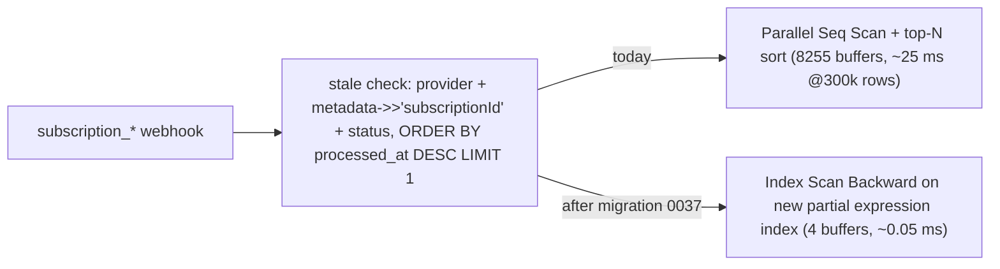

## LS stale-event lookup index

TL;DR: The Lemon Squeezy stale-event guard reads the last applied event for a subscription by filtering `processed_webhook_events.metadata->>'subscriptionId'`, which no index covers, so every subscription webhook seq-scans the whole table and sorts. Add one partial btree expression index on `(metadata->>'subscriptionId', processed_at)`. Schema + generated migration only; no query or `src/` logic change.

### Flowchart



### Task metadata

- Classification: `PERFORMANCE` · `SMALL` · billing / database · medium (migration on webhook table)
- Docs loaded: planning.md, plan-template.md
- Backwards compatibility: Additive. One new index; no column/table/enum/endpoint/exported-symbol change. No `BREAKING CHANGE`.
- Claims reversed while investigating: brief guessed the jsonb key might be `updated_at`; code shows the predicate is `metadata->>'subscriptionId'`; `providerUpdatedAt` is only read from the returned row.
- Detected running model: Opus 5.5 (medium). Recommended: Opus 5.5 medium, single phase. Fallback: Sonnet 5.5.
- Branch: `fix/no-ticket-ls-stale-event-index` from `origin/main` 8393ee3.
- Required skills: graphify (update gate).

### Evidence (read this session)

- Query: `apps/api/src/billing/billing.service.ts:662-672` (`reconcileSubscriptionEvent`):
  `WHERE provider = $1 AND metadata->>'subscriptionId' = $2 AND status = $3 ORDER BY processed_at DESC LIMIT 1`.
- Key written: `billing.service.ts:522-530` `claimMetadata` sets `subscriptionId` only for `subscription_*` events (not `subscription_payment_*`); other events have no key, so a partial `IS NOT NULL` index keeps it small.
- Table: `packages/database/src/schema/index.ts:1446-1461` `processedWebhookEvents`; no indexes besides PK + `event_id` unique (`drizzle/0011_sudden_master_mold.sql`, `drizzle/0023_lemonsqueezy_freemium_billing.sql:139`).
- Driver: `packages/database/src/database.ts:23-27` `postgres(..., { prepare: false })` (custom plans). EXPLAIN below also proves the generic plan (`plan_cache_mode = force_generic_plan`) uses the index.
- Migrations folder: last is `0036_swift_medusa.sql` (journal idx 36); `0037` free. Existing duplicate prefixes 0018-0022, 0024 untouched.
- `schema/index.ts:1-11` imports `index` but not `sql` (no `drizzle-orm` root import yet).
- TDD gate (`scripts/ci/tdd-lib.mjs:16-36`): schema file is not guarded logic; `drizzle/*.sql` needs a migration test or `Migration-Waiver:`. `packages/database/tests/` does not exist.

### EXPLAIN proof

Throwaway `postgres:16-alpine` container, same DDL as the table, 300k rows (200k subscription events over 5k subs with ~5% failed/ignored, 100k order events without the key). Container removed after.

Before (custom and generic plans identical shape):
```
Limit -> Gather Merge -> Sort (top-N heapsort) -> Parallel Seq Scan on processed_webhook_events
  Filter: ((provider = 'lemonsqueezy') AND (status = 'processed') AND ((metadata ->> 'subscriptionId') = '1234'))
  Rows Removed by Filter: 99987 (x3 workers)   Buffers: shared hit=8255   Execution Time: 25.496 ms
```
After, with the exact index definition below (custom plan):
```
Limit -> Index Scan Backward using <index>
  Index Cond: ((metadata ->> 'subscriptionId') = '1234')
  Filter: ((provider = 'lemonsqueezy') AND (status = 'processed'))
  Buffers: shared hit=1 read=3   Execution Time: 0.053 ms
```
After (generic plan): same Index Scan Backward, `Index Cond: ((metadata ->> 'subscriptionId') = $2)`, Buffers 4, 0.231 ms. Unknown id: index scan, 0 rows, 0.061 ms.
(Proof run named the index `processed_webhook_events_subscription_processed_at_idx`; final name below, shape identical.)

### Phase 1 — Index (`Opus 5.5`, medium)

1. `packages/database/src/schema/index.ts`
   Old:
   ```ts
     index,
   } from "drizzle-orm/pg-core";
   ```
   New:
   ```ts
     index,
   } from "drizzle-orm/pg-core";
   import { sql } from "drizzle-orm";
   ```
2. `packages/database/src/schema/index.ts`
   Old:
   ```ts
       receivedAt: timestamp("received_at").defaultNow().notNull(),
       processedAt: timestamp("processed_at").defaultNow().notNull(),
     },
   );

   export const automationJobRuns = pgTable(
   ```
   New:
   ```ts
       receivedAt: timestamp("received_at").defaultNow().notNull(),
       processedAt: timestamp("processed_at").defaultNow().notNull(),
     },
     // Serves the LS stale-event lookup (latest processed event per subscription); the ASC column is read backward for ORDER BY processed_at DESC.
     (t) => [
       index("processed_webhook_events_subscription_id_processed_at_idx")
         .on(sql`(${t.metadata} ->> 'subscriptionId')`, t.processedAt)
         .where(sql`(${t.metadata} ->> 'subscriptionId') IS NOT NULL`),
     ],
   );

   export const automationJobRuns = pgTable(
   ```
3. `bun install --frozen-lockfile` (worktree has no node_modules), then `cd packages/database && bun run db:generate`. Expect exactly one new `drizzle/0037_<random>.sql` + journal + snapshot. Expected SQL:
   ```sql
   CREATE INDEX "processed_webhook_events_subscription_id_processed_at_idx" ON "processed_webhook_events" USING btree (("metadata" ->> 'subscriptionId'),"processed_at") WHERE ("processed_webhook_events"."metadata" ->> 'subscriptionId') IS NOT NULL;
   ```
   Stop rule: if generate emits ANY other statement (snapshot drift) or different index columns, stop and report to parent; no hand edits. Qualified vs unqualified column spelling in WHERE is semantically identical; step 4 proves it.
4. Re-prove on the real migration path: throwaway `postgres:16-alpine` container on a free local port, `DATABASE_URL=... bun packages/database/scripts/migrate.ts` (applies 0000-0037), seed the same synthetic rows, `EXPLAIN (ANALYZE, BUFFERS)` the exact query with custom + generic plan; must show `Index Scan Backward using processed_webhook_events_subscription_id_processed_at_idx`. Remove container.
5. Save this plan to `docs/plans/ls-stale-event-index.md` (first commit), then commit schema + migration: `perf(database): index LS stale-event lookup by subscription id`.

Done: 0037 applies cleanly through `migrate.ts`; EXPLAIN shows the index on custom and generic plans.

### Validation and acceptance

| layer | required? | file | cases |
|---|---|---|---|
| unit/integration | not required: no guarded `src/` logic change; query untouched | — | — |
| migration test | waived: no harness (`packages/database/tests/` absent) | PR body `Migration-Waiver: index-only additive migration; verified by applying 0000-0037 via packages/database/scripts/migrate.ts on a throwaway postgres:16 container and EXPLAIN (custom + generic plan) showing Index Scan Backward on the new index` | — |
| smoke | required | `bun run build` | — |

Run: `bun run typecheck`, `bun run lint`, `CI=true bun run test`, `bun run test:scripts`, `TDD_GATE_BASE=origin/main bun run tdd:gate` (with the waiver text supplied as the gate reads it locally), `bun run build`, `graphify update .`, commit graph refresh.
Mock data: synthetic rows in throwaway containers only; never shared/prod DB.

### Compatibility, docs, scans

- Migration: additive `CREATE INDEX`. Code works without it (no code change; query just stays a seq scan). Rollback if ever needed: `DROP INDEX IF EXISTS "processed_webhook_events_subscription_id_processed_at_idx";`.
- Lock: drizzle migrator runs in a transaction, so no `CONCURRENTLY`; plain `CREATE INDEX` takes a SHARE lock (blocks writes to this table only during the build). API is not serving while container-start migrate runs anyway.
- Write cost: one extra btree insert per `subscription_*` webhook row only (partial); other rows skip it.
- `provider`/`status` kept out of the index: they are bind params; residual Filter runs on a handful of rows per subscription; keeps generic plans valid with zero query change.
- Docs: check `docs/ai/contracts/db-contracts.md` at impl; update only if it lists this table's indexes.
- Optimization scan: nothing further worth doing.
- Data impact: no new round-trips; same columns returned.
