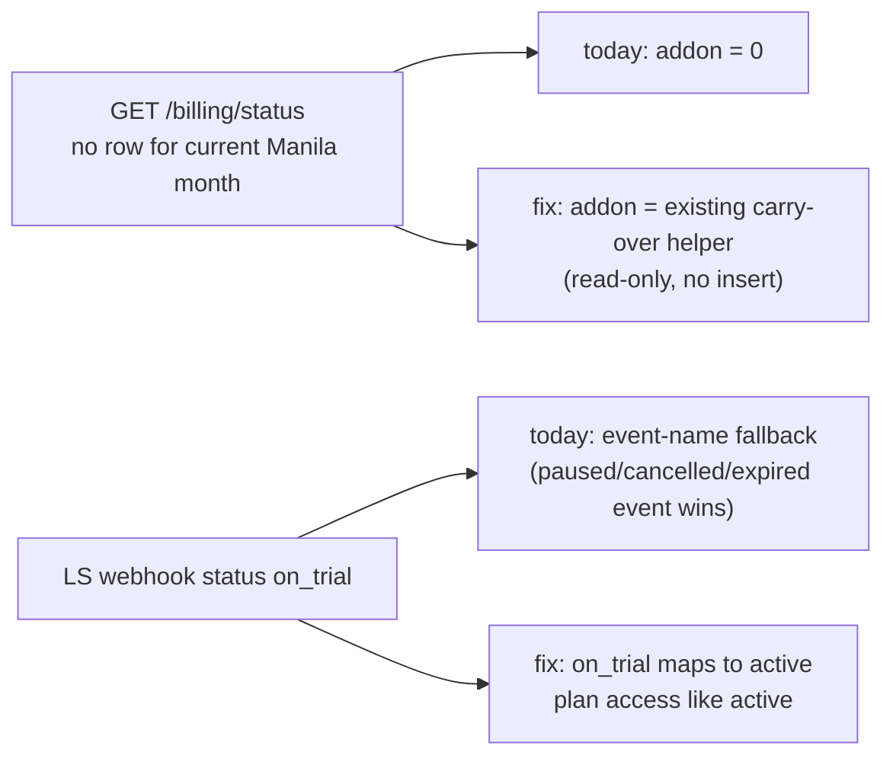

## LS billing status: carried-over add-ons + on_trial mapping

TL;DR: The billing page (`GET /billing/status`) reports SMS and verified-booking add-on credits as 0 on any day of a new Asia/Manila month before something writes that month's ledger row, although the first write will seed the row with the unused paid add-on units carried over from the last month. Fix: when no current-month row exists, compute the same carry-over read-only with the existing helpers and report it; nothing is inserted on GET. Separately, the Lemon Squeezy status `on_trial` is not listed in `resolveSubscriptionStatus`, so it falls to the event-name fallback; map it explicitly to `"active"` (full paid-plan access).

### Flowchart (high-level)



### Task metadata

- Classification: `BUG_FIX` · `SMALL` · billing (apps/api) · medium (paid-credit display, plan access)
- Docs loaded: planning.md, plan-template.md
- Backwards compatibility: `None` breaking. Response shape of `GET /billing/status` unchanged (same fields, only values when no row exists). `SubscriptionStatus` type, `subscription_status` DB enum, `@suki/types` untouched. No migration.
- Claims reversed while investigating: (1) brief said `on_trial` "is not mapped" so trial users lack access. Partly reversed: `resolveSubscriptionStatus` (`apps/api/src/billing/billing.service.ts:1544-1556`) returns `"active"` for any unrecognised status unless the event is `subscription_cancelled|expired|paused`, so `subscription_created/updated` with `on_trial` already store `"active"` today. Real defect = on_trial is decided by the event-name fallback, not the attribute. (2) Brief suggested mapping to the existing `"trialing"` value. Rejected with evidence, see Item 2.
- Root cause (item 1): `getBillingStatus` (`billing.service.ts:128-168`) uses literal `addon: 0` in both "no ledger row" fallbacks; current-month rows are created only by write paths that seed `addon` from `smsAddonCarryover` / `verifiedBookingAddonCarryover` (`billing.service.ts:1178,1222,1427,1465`; `sms-addon-grant.service.ts:168`; `verified-booking-addon-grant.service.ts:174`). Disproved if a GET path inserted the row first — none does: `getVerifiedBookingLedger`/`getSmsLedger` (`:1285-1315`) are select-only.
- Read path proof: `apps/web/src/app/(dashboard)/settings/billing/page.tsx:128,173,219,289,310` call `apiRequest("/billing/status")`; renders `verifiedOnlineBookingCredits.addon` (:441) and `smsSegmentCredits.addon` (:450). Controller `billing.controller.ts:24-35` `getStatus` returns `billingService.getBillingStatus(orgId)` unchanged plus `readOnly`. Web needs no change.
- Detected running model: Opus 5.5 (claude-opus-5-5), medium effort.
- Recommended model: Opus 5.5, medium, for all phases (identical pair, no switch stop); confidence high.
- Branch: `fix/no-ticket-ls-status-addon-trial` from `origin/main` (8393ee3).
- Release path: one PR into `main`, merge commit; parent session merges.
- Discovery note: lookups were literal string searches (`"on_trial"`, `"trialing"`, `"trial_active"`, `addon: 0`) — status values are string literals, not graph symbols, so `grep` was used (permitted fallback: literal string search).
- Execution preflight: worktree `epic-swartz-02c469` sits at `origin/main` 8393ee3, clean. `git checkout -b fix/no-ticket-ls-status-addon-trial origin/main` inside it (this session's own worktree per parent brief).

### Item 2 — why `"active"`, not `"trialing"`

- `mapOrgBillingStatus("trialing")` = `"trial_active"` (`billing.service.ts:1559`), written to `organizations.billingStatus` (`:841`).
- `OrgBillingStateService.deriveState` (`apps/api/src/common/org-billing-state.service.ts:99-135`): status `"trialing"` matches none of the LS branches (`:111-127`), so `effectiveStatus` stays `"trial_active"`, then flips to `"trial_expired"` when `organizations.trialEndsAt` (the in-app signup trial) is past (`:129-135`); `"trial_expired"` is in `READ_ONLY_STATUSES` (`:23-24`). A paying LS trial customer whose old in-app trial ended would be write-blocked.
- `"trialing"` is the in-app signup trial row (`auth.service.ts:215`, `auth.bootstrap.service.ts:76`, provider null), so changing `deriveState` for `"trialing"` would also change those orgs. Out of scope and risky.
- `"active"` gives exactly active's access everywhere (`deriveState:111`, `isLiveLemonSubscription` via `LIVE_SUBSCRIPTION_STATUSES` `org-billing-state.service.ts:38`, `scheduledDowngrade` `billing.service.ts:758`). Trade-off: billing page label shows "Active" during an LS trial (not "Trial"); `subscriptions.trialEndsAt` is still stored from `attributes.trial_ends_at` (`:745`). LS docs: `trial_ends_at` is set only while `on_trial`.

### Phase 1 — RED (Opus 5.5, medium)

All tests in `apps/api/src/billing/billing.service.spec.ts`. Run `bun run tdd:red`, commit `test(billing): cover carried-over add-ons in status and on_trial mapping`.

Item 1 — new `it`s next to "uses persisted verified booking ledger balances in billing status" (~line 600), each spies `getSubscription` → `null` (free fallback, verified included = 5 per `plan-catalog.ts:81`):

1. `edge: billing status reports carried-over sms add-on units before this month's ledger row exists` — `createDbHarness({ previousSmsCredits: [{ included: 300, addon: 100, used: 350 }] })` → `smsSegmentCredits` `{ included: 0, addon: 50, used: 0, total: 50, remaining: 50 }`. Fails today (addon 0).
2. `edge: billing status reports carried-over verified booking add-on units before this month's ledger row exists` — `previousVerifiedCredits: [{ included: 30, addon: 25, used: 40 }]` → `verifiedOnlineBookingCredits` `{ included: 5, addon: 15, used: 0, total: 20, remaining: 20 }`. Fails today.
3. `regression: billing status reads add-ons from an existing current-month row and does not add carry-over again` — `smsCredits: [{ organizationId: "org-1", month: <billingMonthKey()>, included: 0, addon: 10, used: 0 }]`, `previousSmsCredits: [{ included: 0, addon: 100, used: 0 }]` → `smsSegmentCredits.addon` 10. Passes today; guards double counting.
4. `regression: billing status never inserts ledger rows` — case 1+2 harness; after call `state.inserted.smsCredits` and `state.inserted.credits` have length 0. Passes today; guards "no rows on GET".

Item 2 — inside the existing LS describe that defines `lsRow` / `subscriptionEvent` (~line 2556):

5. `edge: on_trial attribute wins over the subscription_paused event-name fallback` — `createDbHarness({ subscriptionsBySql: true, organizations: [{ id: "org-1", currentPlan: "free", billingStatus: "free_active" }], subscriptions: [lsRow()] })`; `reconcileWebhookEvent(subscriptionEvent("subscription_paused", { status: "on_trial" }))` → `state.subscriptions[0].status` `"active"`, `state.updated.organizations[0].billingStatus` `"subscription_active"`. Fails today (`"paused"`).
6. `happy: subscription_created with on_trial grants the paid plan like active` — same harness with `subscriptions: []`, event `subscription_created` `{ status: "on_trial", trial_ends_at: "2026-11-30T00:00:00.000Z" }` → inserted subscription `status: "active"`, `trialEndsAt` = that date; org update `{ currentPlan: "growth", billingStatus: "subscription_active" }`. Passes today; locks behaviour.

error: none — no new failure branch (unknown statuses keep the existing event-name fallback, already covered).

### Phase 2 — GREEN (Opus 5.5, medium)

1. `apps/api/src/billing/billing.service.ts` `getBillingStatus`

Old:
```ts
    const ledger = await this.getVerifiedBookingLedger(organizationId);
    const smsLedger = await this.getSmsLedger(organizationId);
```
New:
```ts
    const ledger = await this.getVerifiedBookingLedger(organizationId);
    const smsLedger = await this.getSmsLedger(organizationId);
    // No row yet this Manila month: show the add-on units the first write will carry over, without creating the row.
    const month = billingMonthKey();
    const verifiedCarryover = ledger ? 0 : await verifiedBookingAddonCarryover(getDb(), organizationId, month);
    const smsCarryover = smsLedger ? 0 : await smsAddonCarryover(getDb(), organizationId, month);
```

2. Same function, verified fallback.

Old:
```ts
      : {
          included: plan.limits.verifiedOnlineBookingsPerMonth,
          addon: 0,
          used: 0,
          total: plan.limits.verifiedOnlineBookingsPerMonth,
          remaining: plan.limits.verifiedOnlineBookingsPerMonth,
        };
```
New:
```ts
      : {
          included: plan.limits.verifiedOnlineBookingsPerMonth,
          addon: verifiedCarryover,
          used: 0,
          total: plan.limits.verifiedOnlineBookingsPerMonth + verifiedCarryover,
          remaining: plan.limits.verifiedOnlineBookingsPerMonth + verifiedCarryover,
        };
```

3. Same function, sms fallback.

Old:
```ts
      : {
          included: 0,
          addon: 0,
          used: 0,
          total: 0,
          remaining: 0,
        };
```
New:
```ts
      : {
          included: 0,
          addon: smsCarryover,
          used: 0,
          total: smsCarryover,
          remaining: smsCarryover,
        };
```

4. `billing.service.ts` `resolveSubscriptionStatus`

Old:
```ts
  ): SubscriptionStatus {
    if (attributeStatus === "active" ||
```
New:
```ts
  ): SubscriptionStatus {
    // LS on_trial gets paid-plan access; "trialing" is the in-app signup trial that expires on organizations.trialEndsAt.
    if (attributeStatus === "on_trial") return "active";
    if (attributeStatus === "active" ||
```

Imports already present (`getDb` :9, carry-over helpers :48, `billingMonthKey` :49). Done: Phase 1 tests green.

### Validation and acceptance

| layer | required | file | cases |
|---|---|---|---|
| API unit | required | `apps/api/src/billing/billing.service.spec.ts` | 1-6 above |
| Web unit | not required — web renders API values unchanged (`page.tsx:441,450`) | — | — |
| DB/migration | not required — no schema change | — | — |
| E2E | not required — no UI/route change | — | — |

Run: `bun run typecheck`, `bun run lint`, `CI=true bun run test`, `bun run test:scripts`, `TDD_GATE_BASE=origin/main bun run tdd:gate`, `bun run build`, then `graphify update .` (code-only change), commit, PR.

Acceptance map: carry-over shown → `getBillingStatus` → steps 1-3 → tests 1,2; no double count → test 3; no GET writes → test 4; on_trial access → `resolveSubscriptionStatus` → step 4 → tests 5,6.

### Compatibility, docs, scans

- `GET /billing/status`: same fields; values differ only when no current-month row exists and a prior row had unused add-on units. Additive in meaning.
- Webhook: `on_trial` stores `"active"` (already the result for created/updated events). No enum/type change.
- Docs: plan saved to `docs/plans/ls-status-addon-trial.md` as first commit. Grep `docs/ai` for `on_trial`/billing status add-on wording before commit; update only if a contract states the old value.
- Data impact: +1 bounded query (`limit(1)`, org-scoped) per ledger only when the current-month row is missing; zero extra queries otherwise. No writes, no transaction needed.
- Optimization scan: the five status reads are sequential today; parallelising is out of scope, left as-is.
- Residual (not fixed, out of scope): `smsSegmentCredits.included` reports 0 before the current-month row exists (verified uses plan limit). Follow-up only.
