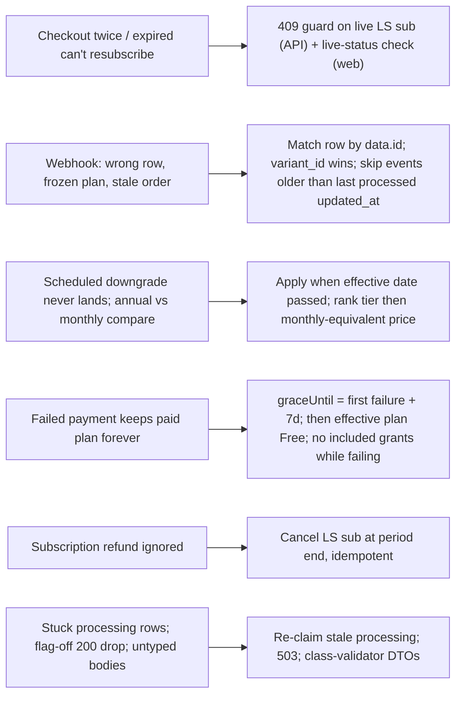

## LS subscription sync fixes (items 1-11)

TL;DR: Lemon Squeezy subscription webhooks are matched to the wrong row, read a plan frozen at checkout, never apply scheduled downgrades, accept out-of-order events, and a second checkout can create a second paid subscription. This plan makes the webhook match by provider subscription id, trust `variant_id`, apply scheduled downgrades at renewal, skip stale events, block double checkout, add Romeo's 7-day past-due grace and refund→cancel policy, and harden the webhook claim, flag-off response, and request validation. No DB migration.

### Flowchart (high-level)



### Task metadata

- Classification: `BUG_FIX` · `LARGE` · billing/webhooks (Deep lane) · risk HIGH (money paths)
- Docs loaded: planning.md, plan-template.md
- Backwards compatibility: Additive, plus the behaviour corrections listed under "Compatibility". None is labelled BREAKING: the 503 and 400 responses were asked for in the brief.
- Claims reversed while investigating: (a) the brief assumed renewal refunds arrive as `order_refunded`. LS docs say renewal refunds are `subscription_payment_refunded`, carrying a subscription-invoice payload (L5), so see D4. (b) CLAUDE.md says "class-validator DTOs" exist, but `grep -rln class-validator apps/api/src` returns nothing. These would be the first DTOs (CONTEXT DRIFT, note only).
- Detected running model: Opus 5.5. Recommended: Opus 5.5 medium for every phase (same pair, so no switch stop). Fallback: Opus 5.5 high.
- Branch: `fix/no-ticket-ls-subscription-sync-v2`, rebased on origin/main d59600c, worktree `.claude/worktrees/beautiful-dirac-1256db` (provided by the parent).
- Release: one PR into main with a merge commit. Merging deploys production and is the user's call.
- Declared deviation: for function bodies over 40 lines, the "Old" block is cited by line range on d59600c rather than pasted. "New" blocks are literal.

### LS facts (fetched this session)

| # | Fact | URL |
|---|---|---|
| L1 | statuses on_trial/active/paused/past_due/unpaid/cancelled/expired; past_due = 4 retries ~2 weeks then unpaid | https://docs.lemonsqueezy.com/api/subscriptions/the-subscription-object |
| L2 | subscription has `updated_at` ISO 8601, `order_id`, `variant_id`; `ends_at` only when cancelled/expired | same |
| L3 | DELETE cancels into grace until renewal (`ends_at`); behaviour on already-cancelled NOT stated | https://docs.lemonsqueezy.com/api/subscriptions/cancel-subscription , https://docs.lemonsqueezy.com/guides/developer-guide/managing-subscriptions |
| L4 | non-2xx retried up to 3 more times (5s/25s/125s); delivery order not stated | https://docs.lemonsqueezy.com/help/webhooks/webhook-requests |
| L5 | `order_refunded` = full or partial refund of an Order; `subscription_payment_refunded` = subscription invoice refunded | https://docs.lemonsqueezy.com/help/webhooks/event-types |
| L6 | custom_data included on Order + Subscription events | https://docs.lemonsqueezy.com/help/checkout/passing-custom-data |
| L7 | variant change effective immediately regardless of proration | https://docs.lemonsqueezy.com/guides/developer-guide/managing-subscriptions |
| L8 | order has no subscription_id; subscription invoice has `subscription_id` | https://docs.lemonsqueezy.com/api/orders/the-order-object , https://docs.lemonsqueezy.com/api/subscription-invoices/the-subscription-invoice-object |

### Decisions for parent (recommended option first)

- D1 (item 8, credits during grace): `messaging/sms-metering.service.ts:41` and `messaging/email-metering.service.ts:31` size new monthly ledgers from `PlanCapacityService.getActivePlan`, which reads `OrgBillingState.currentPlan` (`common/plan-capacity.service.ts:66-75`). That value must stay paid during grace because it also gates modules (`:81-84`). I may not edit `messaging/*`.
  - Recommended: add `includedCreditsPlan` to `OrgBillingState` (Free while an LS subscription is past_due or unpaid) plus `PlanCapacityService.getIncludedCreditsPlan()`. The credit-metering sibling then switches its two calls to it.
  - Intake already blocks during past_due (`intake-booking.service.ts:379`).
  - Alternative: skip this and list it as a residual.
- D2 (`unpaid` counts as live?): the brief's live set leaves out `unpaid`. An unpaid LS subscription still exists and can be recovered (L1), so allowing a new checkout risks two billable subscriptions.
  - Recommended: treat `unpaid` as live. Checkout is blocked and the portal is shown so the owner can fix payment.
- D3 (item 4, where to store the provider `updated_at`): the `subscriptions` table has no spare timestamp column (`schema/index.ts:680-720`).
  - Recommended, no migration: put `subscriptionId` and `providerUpdatedAt` in `processed_webhook_events.metadata`, then compare against the newest processed row with one `limit 1` query. The jsonb filter is unindexed, so its cost grows with webhook volume.
  - Alternative: add a nullable `subscriptions.provider_updated_at` column. The check is O(1), but every `select()` on `subscriptions` fails before the migration applies, which breaks the "code works without the migration" rule.
- D4 (item 9 scope): also cancel on `subscription_payment_refunded`, since renewal refunds arrive that way (L5) and Romeo's rule covers any SUBSCRIPTION charge. Recommended: include it.
- D5 (partial refunds): `order_refunded` also fires on partial refunds (L5). Recommended: any refund cancels at period end (the owner can resume).
- D6 (ranking, as briefed): ranking by tier, then monthly-equivalent price, makes same-tier monthly→annual a downgrade. It is scheduled at renewal ($45 vs $450/12 = $37.50, `plan-catalog.ts:116-117`), while annual→monthly is invoiced immediately. Confirm this is acceptable.

### Phase 1 — RED (Opus 5.5 medium)

Harness change in `billing.service.spec.ts` `createDbHarness` (`:69-342`): add an opt-in `subscriptionsBySql` flag. When set:
- `select/update` on `subscriptions` filter rows by `sqlValues(condition)` (providerSubscriptionId, providerOrderId, id).
- Inserts append rows instead of replacing them.

Also, without the flag:
- The `processedWebhookEvents` select filters on `metadata.subscriptionId` and `providerUpdatedAt`.
- The `onConflictDoUpdate` mock re-claims `processing` rows whose `processedAt` is older than now minus 10 minutes.

Default behaviour stays the same for existing tests.

Tests:

`apps/api/src/billing/billing.service.spec.ts`
- error: createSubscriptionCheckout rejects with 409 when the org has an active Lemon Squeezy subscription (no LS call)
- error: createSubscriptionCheckout rejects with 409 when a cancelled subscription still runs until ends_at
- error: changePlan rejects an expired subscription with 409 SUBSCRIPTION_NOT_ACTIVE (no LS call)
- error: changePlan rejects a cancelled subscription whose ends_at has passed
- error: subscription event without organization_id is stored ignored with reason missing_organization_id
- error: a stale subscription event (updated_at older than the last processed one) is ignored and writes nothing
- error: webhook reconciliation throws 503 BILLING_DISABLED when self-serve billing is off (rewrites `:1669`)
- edge: a delivery stuck in processing for over 10 minutes is re-claimed and reprocessed
- edge: an event for subscription B creates a new row and never overwrites the row tracking subscription A
- edge: an event for an ended subscription does not change the org plan while another live subscription exists
- edge: first event for an org with only a provider-less trial row adopts that row
- edge: past_due keeps the paid plan, sets graceUntil = now+7d and grants no included credits
- edge: a second past_due event keeps the original graceUntil
- edge: past_due arriving after graceUntil sets the org plan to free
- edge: subscription refund replay does not call cancelSubscription again when the row is already cancelled
- edge: subscription refund skips cancelSubscription when Lemon Squeezy already reports it cancelled
- regression: subscription_updated takes plan and interval from variant_id over stale custom_data
- regression: a scheduled downgrade is applied once scheduledChangeEffectiveAt has passed
- regression: annual growth → monthly pro is an immediate upgrade; monthly pro → annual growth is scheduled
- regression: returning to active clears graceUntil
- regression: getBillingStatus reports unpaid as subscription_past_due and trialing as trial_active
- regression: getBillingStatus reports the free plan once the grace period has ended
- regression: order_refunded for a subscription order cancels the LS subscription and marks pending sync refund_cancel
- regression: subscription_payment_refunded cancels the invoice's subscription (D4)
- regression: billing configuration errors name no env key
- happy: createSubscriptionCheckout proceeds when the only subscription is expired
- Existing tests modified (prefix added): `:1669` becomes error: (503), `:1736` becomes regression: (expectation unchanged).

`billing-webhook.controller.spec.ts`: "error: returns 503 when self-serve billing is disabled" (rewrites `:161`).
`billing.controller.spec.ts`: tests run `new ValidationPipe({whitelist:true, forbidNonWhitelisted:true, transform:true}).transform(body, {type:"body", metatype: Dto})`.
- error: checkout rejects planType free
- error: checkout rejects an unknown interval
- error: addon checkout rejects an unknown sku
- error: change-plan rejects an unknown planType
- happy: valid bodies pass

`org-billing-state.service.spec.ts`:
- edge: LS past_due inside grace keeps the paid currentPlan and gives includedCreditsPlan free
- edge: LS unpaid after graceUntil gives free
- regression: null graceUntil keeps the paid plan (legacy rows)
- regression: manual grace unchanged

`settings/billing/page.test.tsx`:
- error: an expired LS subscription starts checkout rather than change-plan
- edge: cancelled past ends_at starts checkout
- regression: active still uses change-plan (`:234`, prefix added)

Run `bun run tdd:red`, then commit `test(billing): red tests for LS subscription sync fixes`.

### Phase 2 — GREEN API (Opus 5.5 medium), `apps/api/src/billing/billing.service.ts` unless named

2.1 Imports. `@nestjs/common` (`:1-6`) adds `ConflictException, Logger`. `drizzle-orm` (`:20`): `import { and, desc, eq, gt, inArray, isNull, lt, ne, or, sql } from "drizzle-orm";`. New import: `import { isLemonGraceExpired, LEMON_PAYMENT_GRACE_MS } from "../common/org-billing-state.service";`.

2.2 After `LemonWebhookPayload` (`:49-58`):
```ts
// unpaid stays live: LS can still recover it, so a new checkout would double-bill (D2).
const LIVE_SUBSCRIPTION_STATUSES = ["active", "trialing", "past_due", "unpaid", "paused"] as const;
const PLAN_TIER_RANK: Record<PlanType, number> = { free: 0, starter: 1, growth: 2, pro: 3 };
const WEBHOOK_PROCESSING_STALE_MS = 10 * 60 * 1000;

type ReconcileOutcome = { status: "processed" | "ignored"; reason?: string };
```
First class member: `private readonly logger = new Logger(BillingService.name);`

2.3 `getBillingStatus` (item 8). Old `:107-108`:
```ts
    const subscription = await this.getSubscription(organizationId);
    const fallbackPlanType = subscription?.planType ?? "free";
```
New:
```ts
    const subscription = await this.getSubscription(organizationId);
    const graceExpired =
      subscription?.provider === "lemonsqueezy" &&
      isLemonGraceExpired(subscription.status, subscription.graceUntil ?? null, new Date());
    const fallbackPlanType = graceExpired ? "free" : subscription?.planType ?? "free";
```
Old `:186-198`, from `return {` to `: "subscription_active",`, which holds `planType: subscription.planType,` and the nested status ternary. New:
```ts
    return {
      planType: fallbackPlanType,
      billingInterval: subscription.billingInterval,
      billingStatus: this.mapOrgBillingStatus(subscription.status, subscription.endsAt ?? null),
```
`mapOrgBillingStatus` (`:1268-1278`): before the final return, add `if (status === "trialing") return "trial_active" as const;`. `OrgBillingStatus` has no trialing value (`packages/types/src/index.ts:120-132`). Webhooks never produce `trialing` (R2), so org writes are unaffected.

2.4 Item 2 guard in `createSubscriptionCheckout`. Old `:221-225`:
```ts
    if (!this.isSelfServeBillingEnabled()) {
      this.throwBillingDisabled();
    }

    const plan = getPlanCatalogEntry(input.planType);
```
New:
```ts
    if (!this.isSelfServeBillingEnabled()) {
      this.throwBillingDisabled();
    }

    if (await this.findLiveLemonSubscriptionId(getDb(), input.organizationId)) {
      throw new ConflictException({
        code: "SUBSCRIPTION_EXISTS",
        message: "This account already has a subscription. Change plan instead of starting a new checkout.",
      });
    }

    const plan = getPlanCatalogEntry(input.planType);
```
New helpers, placed before `resolvePlanType` (`:1213`):
```ts
  private isLiveLemonSubscription(row: { status: string; endsAt?: Date | null }, now = new Date()): boolean {
    if ((LIVE_SUBSCRIPTION_STATUSES as readonly string[]).includes(row.status)) return true;
    return row.status === "cancelled" && !!row.endsAt && row.endsAt.getTime() > now.getTime();
  }

  private async findLiveLemonSubscriptionId(
    db: { select: ReturnType<typeof getDb>["select"] },
    organizationId: string,
    excludeProviderSubscriptionId?: string | null,
  ): Promise<string | null> {
    const [row] = await db
      .select({ id: subscriptions.id })
      .from(subscriptions)
      .where(
        and(
          eq(subscriptions.organizationId, organizationId),
          eq(subscriptions.provider, "lemonsqueezy"),
          or(
            inArray(subscriptions.status, [...LIVE_SUBSCRIPTION_STATUSES]),
            and(eq(subscriptions.status, "cancelled"), gt(subscriptions.endsAt, new Date())),
          ),
          excludeProviderSubscriptionId
            ? ne(subscriptions.providerSubscriptionId, excludeProviderSubscriptionId)
            : undefined,
        ),
      )
      .limit(1);
    return row?.id ?? null;
  }
```

2.5 Item 5 `changePlan`. After the NotFound guard at `:320-322`, before `if (input.planType === "free") {`, insert:
```ts
    if (!this.isLiveLemonSubscription(subscription)) {
      throw new ConflictException({
        code: "SUBSCRIPTION_NOT_ACTIVE",
        message: "This subscription has ended. Start a new checkout to subscribe again.",
      });
    }
```

2.6 Items 6, 7 and 11 in `reconcileWebhookEvent`.
- Old `:483-485` (`return "ignored";` when the flag is off) becomes `this.throwBillingDisabled();`, with the comment "non-2xx so Lemon Squeezy retries once billing is back on".
- After `:488` `const resourceId = …;` add:
```ts
    const isSubscriptionEvent =
      eventName.startsWith("subscription_") && !eventName.startsWith("subscription_payment_");
    const claimMetadata = {
      resourceId,
      ...(isSubscriptionEvent
        ? {
            subscriptionId: resourceId,
            providerUpdatedAt: this.readString(payload.data?.attributes?.updated_at),
          }
        : {}),
    };
```
- Old `:507-521`: insert `metadata: { resourceId }`, the existing comment, and `onConflictDoUpdate`. New:
```ts
        metadata: claimMetadata,
      })
      // Failed deliveries, and claims abandoned mid-processing (crash/timeout), are re-claimable so the
      // provider's retry reprocesses them; a fresh "processing" or completed row stays a duplicate.
      .onConflictDoUpdate({
        target: processedWebhookEvents.eventId,
        set: {
          status: "processing",
          failureReason: null,
          metadata: claimMetadata,
          processedAt: new Date(),
          retryCount: sql`${processedWebhookEvents.retryCount} + 1`,
        },
        setWhere: or(
          eq(processedWebhookEvents.status, "failed"),
          and(
            eq(processedWebhookEvents.status, "processing"),
            lt(processedWebhookEvents.processedAt, new Date(Date.now() - WEBHOOK_PROCESSING_STALE_MS)),
          ),
        ),
      })
```
`processedAt` defaults to now at insert (schema `:1459`), so it holds the claim time.
- Old `:530-554` (`webhookStatus` with the transaction dispatch and the success update). New:
```ts
    let outcome: ReconcileOutcome = { status: "processed" };

    try {
      await db.transaction(async (tx) => {
        // subscription_payment_* carry an invoice, not a subscription; LS sends subscription_updated with each.
        if (isSubscriptionEvent) {
          outcome = await this.reconcileSubscriptionEvent(tx, payload);
        } else if (eventName === "order_created") {
          await this.reconcileOrderCreatedEvent(tx, payload);
        } else if (eventName === "order_refunded") {
          outcome = await this.reconcileOrderRefundedEvent(tx, payload);
        } else if (eventName === "subscription_payment_refunded") {
          outcome = await this.reconcileSubscriptionPaymentRefundedEvent(tx, payload);
        } else {
          outcome = { status: "ignored", reason: "unhandled_event" };
        }
      });

      await db
        .update(processedWebhookEvents)
        .set({
          status: outcome.status,
          metadata: { ...claimMetadata, ...(outcome.reason ? { reason: outcome.reason } : {}) },
          processedAt: new Date(),
        })
        .where(eq(processedWebhookEvents.eventId, deliveryKey));

      return outcome.status;
```
- Failure metadata (`:562-565`) becomes `{ ...claimMetadata, eventName }`.

2.7 Item 10 `getRequiredEnv` (`:573-581`). New body:
```ts
    const value = process.env[name]?.trim();
    if (!value || value.toLowerCase().includes("placeholder")) {
      this.logger.error(`Billing configuration missing required value: ${name}`);
      throw new ServiceUnavailableException({
        code: "BILLING_MISCONFIGURED",
        message: "Billing is temporarily unavailable.",
      });
    }
    return value;
```

2.8 `reconcileSubscriptionEvent` (items 1, 2, 3, 4, 8 and 11). Old `:587-732` is replaced wholesale:
```ts
  private async reconcileSubscriptionEvent(
    tx: {
      select: ReturnType<typeof getDb>["select"];
      insert: ReturnType<typeof getDb>["insert"];
      update: ReturnType<typeof getDb>["update"];
    },
    payload: LemonWebhookPayload,
  ): Promise<ReconcileOutcome> {
    const eventName = payload.meta?.event_name ?? "subscription_updated";
    const eventId = payload.data?.id ?? null;
    const providerSubscriptionId = this.readString(payload.data?.id);
    const attributes = payload.data?.attributes ?? {};
    const customData = payload.meta?.custom_data ?? {};
    const organizationId = this.readString(customData.organization_id);
    if (!organizationId) {
      return { status: "ignored", reason: "missing_organization_id" };
    }

    // LS does not guarantee delivery order; an event older than the last one applied would roll state back.
    const providerUpdatedAt = this.parseDate(attributes.updated_at);
    if (providerSubscriptionId && providerUpdatedAt) {
      const [newer] = await tx
        .select({ id: processedWebhookEvents.id })
        .from(processedWebhookEvents)
        .where(
          and(
            eq(processedWebhookEvents.provider, "lemonsqueezy"),
            eq(processedWebhookEvents.status, "processed"),
            sql`${processedWebhookEvents.metadata}->>'subscriptionId' = ${providerSubscriptionId}`,
            sql`(${processedWebhookEvents.metadata}->>'providerUpdatedAt')::timestamptz > ${providerUpdatedAt.toISOString()}::timestamptz`,
          ),
        )
        .limit(1);
      if (newer) {
        return { status: "ignored", reason: "stale_provider_event" };
      }
    }

    // Match the provider subscription first so an event for subscription A never rewrites the row tracking B.
    const [rowForSubscription] = providerSubscriptionId
      ? await tx
          .select()
          .from(subscriptions)
          .where(
            and(
              eq(subscriptions.organizationId, organizationId),
              eq(subscriptions.providerSubscriptionId, providerSubscriptionId),
            ),
          )
          .limit(1)
      : [];
    let existingSubscription = rowForSubscription;
    if (!existingSubscription) {
      // First event: adopt the org's provider-less row (sign-up trial / manual era) instead of duplicating it.
      const [unclaimed] = await tx
        .select()
        .from(subscriptions)
        .where(
          and(
            eq(subscriptions.organizationId, organizationId),
            isNull(subscriptions.providerSubscriptionId),
          ),
        )
        .orderBy(desc(subscriptions.currentPeriodEnd))
        .limit(1);
      existingSubscription = unclaimed;
    }

    // variant_id is the live LS plan; custom_data is frozen at checkout and only a fallback.
    const variantPlan = this.resolvePlanFromVariantId(
      this.readString(attributes.variant_id),
    );
    const planType = this.resolvePlanType(
      variantPlan?.planType ?? this.readString(customData.plan_type),
      existingSubscription?.planType ?? "free",
    );
    const billingInterval = this.resolveBillingInterval(
      variantPlan?.billingInterval ?? this.readString(customData.billing_interval),
      (existingSubscription?.billingInterval as BillingInterval | null) ?? null,
    );
    const status = this.resolveSubscriptionStatus(
      eventName,
      this.readString(attributes.status),
    );
    const now = new Date();
    const renewsAt = this.parseDate(attributes.renews_at);
    const endsAt = this.parseDate(attributes.ends_at);
    // LS subscription objects carry no current_period_*; renews_at (or ends_at once cancelled) closes the paid cycle.
    const providerPeriodEnd = renewsAt ?? endsAt;
    const currentPeriodStart =
      this.parseDate(attributes.current_period_start) ??
      (providerPeriodEnd
        ? this.subtractBillingInterval(providerPeriodEnd, billingInterval ?? "monthly")
        : null) ??
      existingSubscription?.currentPeriodStart ??
      now;
    const currentPeriodEnd =
      this.parseDate(attributes.current_period_end) ??
      providerPeriodEnd ??
      existingSubscription?.currentPeriodEnd ??
      currentPeriodStart;
    const trialEndsAt = this.parseDate(attributes.trial_ends_at);
    const cancelled = this.readBoolean(attributes.cancelled)
      ? "true"
      : status === "cancelled" || status === "expired"
        ? "true"
        : "false";
    const urls = (attributes.urls ?? {}) as Record<string, unknown>;
    const scheduledChangeDue =
      existingSubscription?.scheduledChangeEffectiveAt instanceof Date &&
      existingSubscription.scheduledChangeEffectiveAt.getTime() <= now.getTime();
    const scheduledDowngrade =
      !!existingSubscription &&
      !scheduledChangeDue &&
      status === "active" &&
      existingSubscription.status === "active" &&
      planType !== "free" &&
      this.isScheduledDowngrade(
        existingSubscription.planType,
        (existingSubscription.billingInterval as BillingInterval | null) ?? "monthly",
        planType,
        billingInterval ?? "monthly",
      );
    const appliedPlanType = scheduledDowngrade
      ? existingSubscription?.planType ?? planType
      : planType;
    const paymentFailing = status === "past_due" || status === "unpaid";
    const wasFailing =
      existingSubscription?.status === "past_due" || existingSubscription?.status === "unpaid";
    // Grace runs 7 days from the first failure we saw; later retries must not extend it.
    const graceUntil = paymentFailing
      ? (wasFailing ? existingSubscription?.graceUntil ?? null : null) ??
        new Date(now.getTime() + LEMON_PAYMENT_GRACE_MS)
      : null;
    const nextOrgPlan =
      status === "expired" || isLemonGraceExpired(status, graceUntil, now)
        ? "free"
        : appliedPlanType;

    const subscriptionValues = {
      organizationId,
      planType: appliedPlanType,
      status,
      provider: "lemonsqueezy" as const,
      providerSubscriptionId: providerSubscriptionId ?? existingSubscription?.providerSubscriptionId ?? null,
      providerCustomerId: this.readString(attributes.customer_id),
      providerOrderId: this.readString(attributes.order_id),
      providerProductId: this.readString(attributes.product_id),
      providerVariantId: this.readString(attributes.variant_id),
      providerSubscriptionItemId: this.readString(
        (attributes.first_subscription_item as Record<string, unknown> | undefined)?.id,
      ),
      billingInterval: billingInterval ?? existingSubscription?.billingInterval ?? null,
      cancelled,
      currentPeriodStart,
      currentPeriodEnd,
      renewsAt,
      endsAt,
      trialEndsAt,
      graceUntil,
      cardBrand: this.readString(attributes.card_brand),
      cardLastFour: this.readString(attributes.card_last_four),
      updatePaymentMethodUrl: this.readString(urls.update_payment_method),
      customerPortalUrl: this.readString(urls.customer_portal),
      lastProviderEventId: eventId,
      // plan_price_php is NOT NULL and PHP-denominated; Lemon Squeezy charges USD, so no PHP amount applies.
      planPricePhp: 0,
      scheduledPlanType: scheduledDowngrade ? planType : null,
      scheduledBillingInterval: scheduledDowngrade ? billingInterval : null,
      // keep the date changePlan set; re-deriving from renews_at would slide the due date forward every event
      scheduledChangeEffectiveAt: scheduledDowngrade
        ? existingSubscription?.scheduledChangeEffectiveAt ?? renewsAt ?? currentPeriodEnd
        : null,
      ...this.clearPendingSync(),
    };

    if (existingSubscription?.id) {
      await tx
        .update(subscriptions)
        .set(subscriptionValues)
        .where(eq(subscriptions.id, existingSubscription.id));
    } else {
      await tx.insert(subscriptions).values(subscriptionValues);
    }

    // A late event for an ended subscription must not downgrade an org that already runs a newer one.
    if (
      !this.isLiveLemonSubscription({ status, endsAt }, now) &&
      (await this.findLiveLemonSubscriptionId(tx, organizationId, providerSubscriptionId))
    ) {
      return { status: "processed", reason: "superseded_subscription" };
    }

    await tx
      .update(organizations)
      .set({
        currentPlan: nextOrgPlan,
        billingStatus: this.mapOrgBillingStatus(status, endsAt),
        nextBillingDueAt: renewsAt,
        // manual-era access dates would otherwise force "suspended" in OrgBillingStateService
        accessEndsAt: null,
        billingPausedAt: null,
        updatedAt: now,
      })
      .where(eq(organizations.id, organizationId));

    // No included-credit grants while a payment is failing.
    if (!scheduledDowngrade && !paymentFailing && nextOrgPlan !== "free" && status !== "expired") {
      await this.reconcileIncludedBookingCredits(tx, {
        organizationId,
        eventId,
        planType: nextOrgPlan,
        currentPeriodStart,
      });
      await this.syncIncludedEmailCredits(tx, organizationId, nextOrgPlan);
    }

    return { status: "processed" };
  }
```

2.9 Item 9 refunds. In `reconcileOrderRefundedEvent`, the return type `Promise<void>` (`:789`) becomes `Promise<ReconcileOutcome>`. Before the `if (!organizationId || !purchaseKind || !sku)` guard (`:795`) insert:
```ts
    if (organizationId && purchaseKind === "subscription" && eventId) {
      // the subscription row stores LS attributes.order_id; orders carry no subscription_id
      return this.cancelRefundedSubscription(tx, organizationId, eq(subscriptions.providerOrderId, eventId));
    }
```
That guard's `return;` (`:796`) becomes `return { status: "ignored", reason: "missing_refund_metadata" };`. In the top-up branches, the bare `return;` at `:819`, `:851`, `:873` and the end of the function become `return { status: "processed" };`. This is a type-only change with no logic touched.

New methods:
```ts
  private async reconcileSubscriptionPaymentRefundedEvent(
    tx: {
      select: ReturnType<typeof getDb>["select"];
      update: ReturnType<typeof getDb>["update"];
    },
    payload: LemonWebhookPayload,
  ): Promise<ReconcileOutcome> {
    const organizationId = this.readString(payload.meta?.custom_data?.organization_id);
    const subscriptionId = this.readString(payload.data?.attributes?.subscription_id);
    if (!organizationId || !subscriptionId) {
      return { status: "ignored", reason: "missing_refund_metadata" };
    }
    return this.cancelRefundedSubscription(tx, organizationId, eq(subscriptions.providerSubscriptionId, subscriptionId));
  }

  // Refunded subscription charge → cancel at period end. Replays must not cancel twice.
  private async cancelRefundedSubscription(
    tx: {
      select: ReturnType<typeof getDb>["select"];
      update: ReturnType<typeof getDb>["update"];
    },
    organizationId: string,
    match: ReturnType<typeof eq>,
  ): Promise<ReconcileOutcome> {
    const [row] = await tx
      .select({
        id: subscriptions.id,
        providerSubscriptionId: subscriptions.providerSubscriptionId,
        status: subscriptions.status,
        cancelled: subscriptions.cancelled,
        billingInterval: subscriptions.billingInterval,
      })
      .from(subscriptions)
      .where(and(eq(subscriptions.organizationId, organizationId), eq(subscriptions.provider, "lemonsqueezy"), match))
      .limit(1);
    if (!row?.providerSubscriptionId) {
      return { status: "ignored", reason: "refunded_subscription_not_found" };
    }
    if (row.cancelled === "true" || row.status === "cancelled" || row.status === "expired") {
      return { status: "processed", reason: "subscription_already_cancelled" };
    }

    // LS does not document DELETE on an already-cancelled subscription, so check first.
    const provider = await this.lemonsqueezy.getSubscription(row.providerSubscriptionId);
    const providerAttributes = (provider.data?.attributes ?? {}) as Record<string, unknown>;
    const providerStatus = this.readString(providerAttributes.status);
    if (!this.readBoolean(providerAttributes.cancelled) && providerStatus !== "cancelled" && providerStatus !== "expired") {
      await this.lemonsqueezy.cancelSubscription(row.providerSubscriptionId);
    }

    await tx
      .update(subscriptions)
      .set({
        pendingSyncAction: "refund_cancel",
        pendingSyncStartedAt: new Date(),
        pendingSyncTargetPlanType: "free",
        pendingSyncTargetBillingInterval: row.billingInterval,
        updatedAt: new Date(),
      })
      .where(eq(subscriptions.id, row.id));
    return { status: "processed", reason: "refund_cancelled_subscription" };
  }
```

2.10 Item 3 ranking. Old `:1420-1436` (`isScheduledDowngrade` and `priceForPlan`; `priceForPlan` has no other caller per grep). New:
```ts
  private isScheduledDowngrade(
    currentPlan: PlanType,
    currentInterval: BillingInterval,
    nextPlan: Exclude<PlanType, "free">,
    nextInterval: BillingInterval,
  ): boolean {
    const tierDelta = PLAN_TIER_RANK[nextPlan] - PLAN_TIER_RANK[currentPlan];
    if (tierDelta !== 0) return tierDelta < 0;
    return this.monthlyEquivalentPriceUsd(nextPlan, nextInterval) < this.monthlyEquivalentPriceUsd(currentPlan, currentInterval);
  }

  // Annual sticker prices cover 12 months; compare per month or every annual plan looks pricier than any monthly one.
  private monthlyEquivalentPriceUsd(planType: PlanType, interval: BillingInterval | null | undefined): number {
    if (planType === "free") return 0;
    const plan = getPlanCatalogEntry(planType);
    if (interval === "annual" && plan.annualPriceUsd !== null) {
      return plan.annualPriceUsd / 12;
    }
    return plan.monthlyPriceUsd;
  }
```

2.11 `apps/api/src/common/org-billing-state.service.ts`. Add after `:33`:
```ts
export const LEMON_PAYMENT_GRACE_MS = 7 * 24 * 60 * 60 * 1000;

// Null graceUntil = row written before the grace policy; keep the paid plan until the next webhook sets one.
export function isLemonGraceExpired(status: string, graceUntil: Date | null, now: Date): boolean {
  return (status === "past_due" || status === "unpaid") && graceUntil instanceof Date && graceUntil.getTime() <= now.getTime();
}
```
- Interface: add `includedCreditsPlan: PlanType;` (D1).
- In `deriveState`, move `manualSubscription` (`:83`) above `:80`, then replace `const plan = (org.currentPlan ?? "free") as PlanType;` with:
```ts
    const lemonPaymentFailing =
      !manualSubscription && (org.subscriptionStatus === "past_due" || org.subscriptionStatus === "unpaid");
    const plan =
      lemonPaymentFailing && isLemonGraceExpired(org.subscriptionStatus ?? "", org.subscriptionGraceUntil ?? null, now)
        ? "free"
        : ((org.currentPlan ?? "free") as PlanType);
```
- The return object adds `includedCreditsPlan: lemonPaymentFailing ? "free" : plan,`.
- `plan-capacity.service.ts` adds `getIncludedCreditsPlan(organizationId)`, which returns `state?.includedCreditsPlan ?? "free"`.
- If D1 is rejected, drop the field and the method.

2.12 `billing-webhook.controller.ts` (`:37-42`): the flag-off `return { received: true, duplicate: false }` becomes the following, with `ServiceUnavailableException` imported:
```ts
      // non-2xx so Lemon Squeezy retries instead of the event being dropped
      throw new ServiceUnavailableException({ code: "BILLING_DISABLED", message: "Self-serve billing is disabled." });
```

2.13 New file `apps/api/src/billing/billing.dto.ts`. No DTO exists in `apps/api` yet. It reuses `BILLING_INTERVALS` (`plan-catalog.ts:49`) and `BILLING_ADDON_CATALOG` (`:182`).
```ts
import { IsIn, IsOptional } from "class-validator";
import type { BillingAddonSku, BillingInterval, PlanType } from "@suki/types";
import { BILLING_ADDON_CATALOG, BILLING_INTERVALS } from "./plan-catalog";

const PAID_PLAN_TYPES = ["starter", "growth", "pro"] as const;
// free stays accepted so changePlan keeps its "use cancellation" message
const CHANGE_PLAN_TYPES = ["free", ...PAID_PLAN_TYPES] as const;
const ADDON_SKUS = BILLING_ADDON_CATALOG.map((addon) => addon.sku);

export class CreateCheckoutDto {
  @IsIn(PAID_PLAN_TYPES)
  planType!: Exclude<PlanType, "free">;

  @IsIn(BILLING_INTERVALS)
  billingInterval!: BillingInterval;
}

export class CreateAddonCheckoutDto {
  @IsIn(ADDON_SKUS)
  sku!: BillingAddonSku;
}

export class ChangePlanDto {
  @IsIn(CHANGE_PLAN_TYPES)
  planType!: PlanType;

  @IsOptional()
  @IsIn(BILLING_INTERVALS)
  billingInterval?: BillingInterval;
}
```
- `billing.controller.ts` inline bodies (`:54-58`, `:77-89`, `:113-117`) become `CreateCheckoutDto`, `CreateAddonCheckoutDto` and `ChangePlanDto`. Use a value import so the decorator metadata survives.
- The web sends exactly these fields (`page.tsx:204,215,235`), so `forbidNonWhitelisted` (`main.ts:100-104`) passes them.

### Phase 3 — GREEN web (Opus 5.5 medium)

`apps/web/src/app/(dashboard)/settings/billing/page.tsx:188-189`. Old:
```tsx
  // Sign-up creates a trial subscription row with no provider; only a Lemon Squeezy row can be changed, cancelled, or managed.
  const hasLemonSubscription = billing?.subscription?.provider === "lemonsqueezy";
```
New:
```tsx
  // Sign-up creates a trial subscription row with no provider; only a live Lemon Squeezy row can be changed, cancelled, or managed.
  // An ended one (expired, or cancelled past ends_at) falls back to checkout; mirrors BillingService.isLiveLemonSubscription.
  const hasLemonSubscription = isLiveLemonSubscription(billing?.subscription ?? null);
```
Module-level helper:
```tsx
const LIVE_SUBSCRIPTION_STATUSES = ["active", "trialing", "past_due", "unpaid", "paused"];

function isLiveLemonSubscription(subscription: Record<string, unknown> | null): boolean {
  if (subscription?.provider !== "lemonsqueezy") return false;
  const status = typeof subscription.status === "string" ? subscription.status : "";
  if (LIVE_SUBSCRIPTION_STATUSES.includes(status)) return true;
  const endsAt = typeof subscription.endsAt === "string" ? Date.parse(subscription.endsAt) : Number.NaN;
  return status === "cancelled" && endsAt > Date.now();
}
```

### Phase 4 — Validate and close (Opus 5.5 medium)

1. Run the targeted vitest suites: api `src/billing` and `src/common/org-billing-state.service.spec.ts`, plus web `settings/billing`.
2. Run `bun run typecheck`, `bun run lint`, `CI=true bun run test`, `bun run test:scripts`, `TDD_GATE_BASE=origin/main bun run tdd:gate` and `bun run build`.
3. Run `graphify update .` and commit `graphify-out`.
4. The first commit on the branch is `docs/plans/ls-subscription-sync-v2.md`.
5. Push, run `gh auth switch --hostname github.com --user OwlRepo`, and open one PR into main.

### Test matrix

| layer | required | file |
|---|---|---|
| API service | yes | billing.service.spec.ts |
| API controllers + DTO | yes | billing.controller.spec.ts, billing-webhook.controller.spec.ts |
| API state | yes | org-billing-state.service.spec.ts |
| Web | yes | settings/billing/page.test.tsx |
| Migration | no (none) | — |
| Live LS sandbox | not run: no LS test credentials here (UNVERIFIED end-to-end) | — |

### Compatibility

| surface | verdict |
|---|---|
| POST /billing/checkout | adds 409 SUBSCRIPTION_EXISTS and 400 for invalid bodies; current web bodies are unaffected |
| POST /billing/change-plan | adds 409 SUBSCRIPTION_NOT_ACTIVE. Today it PATCHes an ended LS subscription instead |
| POST /billing/addons/checkout | 400 on an unknown sku |
| webhook, flag off | 200 becomes 503. LS retries 3 times, then the delivery must be resent by hand |
| GET /billing/status | `planType` shows free after grace; trialing shows trial_active; unpaid shows past_due; no fields removed |
| OrgBillingState | additive `includedCreditsPlan` |
| 503 config error | message no longer names the env key; code `BILLING_MISCONFIGURED` |
| DB | no change; uses the existing `grace_until` column (`drizzle/0010_gigantic_eternity.sql:81`) |

### Data impact

- Subscription webhook:
  - +1 `limit 1` stale check (unindexed jsonb, see D3).
  - +1 select only on an org's first event.
  - +1 `limit 1` only for non-live events.
- Checkout: +1 `limit 1`.
- All of these run inside the existing transaction and are scoped by org.
- The refund path makes 1-2 LS HTTP calls inside the transaction. It is replay-safe because it reads the subscription (GET) before cancelling (DELETE).

### Residuals (not fixed)

- R1: wiring D1 into `messaging/*-metering.service.ts` is the credit-metering sibling's work.
- R2 CONTRACT DRIFT: LS sends `on_trial`, but `resolveSubscriptionStatus` (`:1254-1266`) only knows `trialing`, so `on_trial` falls back to `active`.
- R3: `cancel` and `resume` (`:389-448`) do not check liveness.
- R4 CONTEXT DRIFT: CLAUDE.md claims class-validator DTOs exist.
- R5: the `buildOwnerWarnings` refund_review query (`:1097-1101`) has no ordering, so it returns an arbitrary row.
- R6: two deliveries for the same subscription in parallel transactions can still interleave.

### Hand-over

- Top-up refund session: `reconcileOrderRefundedEvent` now returns `ReconcileOutcome`, and subscription refunds are routed before the `!sku` guard.
- Credit-metering session: if D1 is approved, use `getIncludedCreditsPlan` at `sms-metering.service.ts:41` and `email-metering.service.ts:31`.

### Approved decisions (override the plan text where they differ)

- D1 approved: add `OrgBillingState.includedCreditsPlan` and `PlanCapacityService.getIncludedCreditsPlan()`. `apps/api/src/messaging/*` is not edited; the credit-metering session switches its calls.
- D2 approved: `unpaid` counts as live.
- D3 approved (metadata approach), with one bounded stale lookup: select the newest processed `processed_webhook_events` row for `provider = 'lemonsqueezy'` and `metadata->>'subscriptionId' = $1` (`ORDER BY processed_at DESC LIMIT 1`), then compare that row's `providerUpdatedAt` with the incoming `attributes.updated_at` in code. Strictly older incoming events are ignored with reason `stale_provider_event`. No index is added (residual).
- D4 approved: handle `subscription_payment_refunded`.
- D5 changed: only a FULL refund cancels at period end. Full vs partial comes from payload `attributes.status`: `refunded` = full, `partial_refund` = partial (order object https://docs.lemonsqueezy.com/api/orders/the-order-object ; subscription invoice object https://docs.lemonsqueezy.com/api/subscription-invoices/the-subscription-invoice-object ). A partial refund cancels nothing, calls no LS API, and returns `{ status: "processed", reason: "partial_refund_review" }` with `refundedAmount` (`attributes.refunded_amount`, cents) recorded in the processed row metadata; `ReconcileOutcome` gains optional `metadata` merged into the final processed-row metadata. Any other status on a subscription refund event is ignored with reason `refund_status_unrecognized`.
- D6 changed: rank by tier first; within the same tier annual ranks above monthly. `rank = PLAN_TIER_RANK[plan] * 2 + (interval === "annual" ? 1 : 0)`; downgrade iff `rank(next) < rank(current)`. The monthly-equivalent price comparison and `priceForPlan` are dropped. Tests: "regression: annual growth → monthly pro is an immediate upgrade; monthly pro → annual growth is scheduled" still holds, plus "regression: same-tier monthly → annual is an immediate upgrade; annual → monthly is scheduled".
- Top-up branch `return;` → `return { status: "processed" }` approved (type-only).
