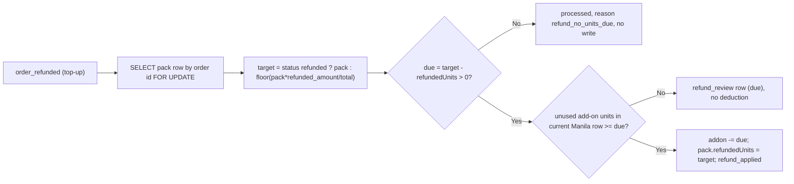

## LS top-up refunds: idempotent, pro rata, month-correct

TL;DR: `order_refunded` for an SMS / verified-booking top-up deducts the full SKU pack every time the webhook arrives with a new body, and ignores partial refunds. Root cause: `BillingService.reconcileOrderRefundedEvent` (`apps/api/src/billing/billing.service.ts:912-1045`) sizes the deduction from `addon.units` (SKU) and never reads the pack row's `refundedUnits` before deducting; the row is only written afterwards (`markVerifiedBookingAddonRefunded` :1621-1651, `markSmsAddonRefunded` :1653-1683). Fix: lock and read the pack row first, compute the cumulative refunded-unit target from LS amounts, deduct only the difference.

### Flowchart



### Task metadata

- Classification: `BUG_FIX` · `SMALL` · billing (API only) · high (money/credits)
- Docs loaded: planning.md, plan-template.md
- Backwards compatibility: no `BREAKING CHANGE`. No endpoint/column/enum change, no migration. Private helpers `markSmsAddonRefunded` / `markVerifiedBookingAddonRefunded` removed (private; only callers :971, :1025). Behaviour change for tenants = the bug fix: duplicate / partial refunds stop over-deducting. Payloads without `status`/amounts keep today's full-pack deduction.
- Claims reversed: none.
- Detected running model: Opus 5.5 (medium). Recommended: Opus 5.5 medium both phases (same pair, no stop).
- Branch: `fix/no-ticket-ls-topup-refunds` (rebased on `origin/main` dd3ab2f).

### LS evidence (fetched 2026-11-17)

- https://docs.lemonsqueezy.com/help/webhooks/event-types — `order_refunded`: "Occurs when a full or partial refund is made on an order." Payload = Order object.
- https://docs.lemonsqueezy.com/api/orders/the-order-object — `status` one of `pending, failed, paid, refunded, partial_refund, fraudulent`; `refunded` true only when fully refunded; `refunded_amount` and `total` "positive integer in cents".
- https://docs.lemonsqueezy.com/api/orders/issue-refund — "Issues a partial or full refund"; example partial refund of 100 returns `refunded_amount: 100`.
- UNVERIFIED DEPENDENCY: docs do not state `refunded_amount` is cumulative across several partial refunds. Design is safe either way: cumulative = exact; per-refund = can only UNDER-deduct, and a final full refund (`status: "refunded"`) tops up to the full pack.

### Rounding / no over-deduction

`target = status === "refunded" ? packUnits : min(packUnits, floor(packUnits * refunded_amount / total))`. `due = target - pack.refundedUnits`; deduct only when `due > 0`; then `refundedUnits := target`. refundedUnits is monotonic and `<= packUnits`, so the sum of all deductions for one order == final refundedUnits `<= packUnits`. Floor rounds toward the customer keeping units (deduction never exceeds the refunded share). Integer cents x units (<= 250): no float drift that matters, `Math.floor` on an exact rational. Row lock (`FOR UPDATE`) serialises two concurrent deliveries for one order (different delivery keys = different `processed_webhook_events` rows, so the claim at :540-575 does not serialise them); second reads the updated refundedUnits.

Payload handling:
- `status: "refunded"` → full pack.
- integer `refunded_amount > 0` and `total > 0` → pro rata.
- `status: "partial_refund"` but amounts unreadable → `ignored`, reason `refund_amount_unreadable`, no write (never guess a partial size).
- no status and no amounts (legacy shape; every existing spec uses `attributes: {}`) → full pack, today's behaviour.

### Item 3 — month correctness (verified, no change needed)

- `getOrCreateVerifiedBookingLedger` / `getOrCreateSmsLedger` (`billing.service.ts:1413-1478`) read/create the `billingMonthKey()` row (Manila, `common/billing-month.ts:4-7`); a new row seeds `addonGranted` / `addon` from `verifiedBookingAddonCarryover` / `smsAddonCarryover` (`addon-carryover.ts:16-51`) = unused add-on units (`unusedAddonUnits`, :7-13, included spent first) of the latest earlier row.
- Carry-over is read once, when a month row is created, from the latest earlier row only; earlier rows are history. So every unused unit of a pack bought in an earlier month lives in the current row. Deducting `due` from the current row is correct. Existing specs `billing.service.spec.ts:1809`, `:1827` cover a refund that creates the current row with carried units.
- `refund_review` path kept: `unusedAddonUnits(current row) < due` → review row, no deduction, pack row untouched (never negative). Reuse `unusedAddonUnits` from `addon-carryover.ts` (same formula as inline :939 / :993).

### Item 4 — missing pack row

No row for `(org, source='lemonsqueezy', source_reference=order id)` → packUnits = SKU units, refundedUnits = 0, deduct as today (pro rata if amounts present), mark no pack, outcome `{ status: "processed", reason: "refund_addon_not_found" }` (lands in `processed_webhook_events.metadata.reason` via :594-604) plus `addonRecord: "not_found"` in the reconciliation row metadata. Known limit (code comment, `shortcut:` form): without a row, replays cannot be detected.

### Phase 1 — RED (Opus 5.5, medium)

File `apps/api/src/billing/billing.service.spec.ts`.

Harness (test code): non-orderBy `limit` (:256) returns its promise extended with `.for(mode)` that pushes `table` to new `state.lockedTables` and returns the same promise. Literal: rename body `limit: async () => {...}` to `const resolveLimit = async () => {...}`; `limit: () => { const rows = resolveLimit(); return Object.assign(rows, { for: () => { state.lockedTables.push(table); return rows; } }); }`; `state.lockedTables: [] as unknown[]`.

New tests:
1. `error: a partial top-up refund with no readable amount deducts nothing` — sms pack 50, `{status:"partial_refund"}` → returns `"ignored"`, no credit update, no reconciliation insert, processed metadata reason `refund_amount_unreadable`.
2. `edge: a second order_refunded for a fully refunded sms pack deducts nothing` — pack `packSize 50, refundedUnits 50`, `{status:"refunded", refunded_amount:999, total:999}` → no credit update, no reconciliation insert, reason `refund_no_units_due`.
3. `edge: a partial sms top-up refund deducts the floored pro rata share` — pack 50, ledger included 0 addon 50 used 0, `{status:"partial_refund", refunded_amount:333, total:999}` → addon 34, pack refundedUnits 16, `refund_applied` metadata refundedUnits 16.
4. `edge: a full refund after a partial one deducts only the remaining units` — pack refundedUnits 16, ledger addon 34, `{status:"refunded"}` → addon 0, refundedUnits 50, metadata refundedUnits 34.
5. `edge: a partial refund that floors to zero units deducts nothing` — pack 25, `{status:"partial_refund", refunded_amount:1, total:999}` → no write, reason `refund_no_units_due`.
6. `edge: a partial booking top-up refund deducts the floored pro rata share` — booking pack units 25, addonGranted 25, `{status:"partial_refund", refunded_amount:500, total:1000}` → addonGranted 13, refundedUnits 12.
7. `edge: a top-up refund with no matching pack records refund_addon_not_found` — no pack row, sms addon 25 → addon 0, processed metadata reason `refund_addon_not_found`.
8. `regression: a top-up refund locks the refunded pack row before deducting` — `state.lockedTables` contains `smsAddons`; booking variant contains `verifiedOnlineBookingAddons`.
9. `regression: a partial refund larger than the unused add-on units opens a review for the due units only` — pack 50 refundedUnits 0, ledger included 0 addon 50 used 40, `{status:"partial_refund", refunded_amount:600, total:1000}` (due 30 > unused 10) → `refund_review` metadata refundedUnits 30, pack untouched.

Existing tests untouched (all `attributes: {}` → full-pack path). `bun run tdd:red`; commit `test(billing): cover idempotent and partial top-up refunds`.

### Phase 2 — GREEN (Opus 5.5, medium)

`apps/api/src/billing/billing.service.ts`:

a) Extend the existing `./addon-carryover` import with `unusedAddonUnits`.

b) Replace :935-1045 (from `const addon = resolveAddonSku(...)` to the end of `reconcileOrderRefundedEvent`) with:

```ts
    const addon = resolveAddonSku(sku as BillingAddonSku);
    if (purchaseKind !== "online_booking_topup" && purchaseKind !== "sms_segment_topup") {
      return { status: "processed" };
    }
    const isBooking = purchaseKind === "online_booking_topup";
    const packTable = isBooking ? verifiedOnlineBookingAddons : smsAddons;
    // Lock the refunded order's pack: concurrent deliveries for one order must not both deduct.
    const [pack] = eventId
      ? await tx
          .select({
            id: packTable.id,
            units: isBooking ? verifiedOnlineBookingAddons.units : smsAddons.packSize,
            refundedUnits: packTable.refundedUnits,
          })
          .from(packTable)
          .where(
            and(
              eq(packTable.organizationId, organizationId),
              eq(packTable.source, "lemonsqueezy"),
              eq(packTable.sourceReference, eventId),
            ),
          )
          .limit(1)
          .for("update")
      : [];
    const target = this.refundTargetUnits(payload.data?.attributes ?? {}, pack?.units ?? addon.units);
    if (target === null) return { status: "ignored", reason: "refund_amount_unreadable" };
    const due = target - (pack?.refundedUnits ?? 0);
    if (due <= 0) return { status: "processed", reason: "refund_no_units_due" };
    // shortcut: without a pack row (legacy grant) a replay cannot be detected; every LS grant since #11 has one.
    const notFound = pack ? {} : { reason: "refund_addon_not_found" };
    const metadata = { sku: addon.sku, refundedUnits: due, ...(pack ? {} : { addonRecord: "not_found" }) };

    const ledger = isBooking
      ? await this.getOrCreateVerifiedBookingLedger(tx, organizationId)
      : await this.getOrCreateSmsLedger(tx, organizationId);
    const included = "includedGranted" in ledger ? ledger.includedGranted : ledger.included;
    const addonBefore = "addonGranted" in ledger ? ledger.addonGranted : ledger.addon;
    const base = {
      organizationId,
      creditType: isBooking ? ("verified_online_booking" as const) : ("sms_segment" as const),
      month: ledger.month,
      includedBefore: included,
      includedAfter: included,
      addonBefore,
      usedBefore: ledger.used,
      usedAfter: ledger.used,
      providerEventId: eventId,
      metadata,
    };
    if (unusedAddonUnits({ included, addon: addonBefore, used: ledger.used }) < due) {
      await tx.insert(creditReconciliationEvents).values({ ...base, eventType: "refund_review", addonAfter: addonBefore });
      return { status: "processed", ...notFound };
    }

    // unused <= addonBefore and unused >= due, so this never goes negative
    const addonAfter = addonBefore - due;
    if (isBooking) {
      await tx
        .update(verifiedOnlineBookingCredits)
        .set({ addonGranted: addonAfter, used: ledger.used, updatedAt: new Date() })
        .where(and(eq(verifiedOnlineBookingCredits.organizationId, organizationId), eq(verifiedOnlineBookingCredits.month, ledger.month)));
    } else {
      await tx
        .update(smsCredits)
        .set({ addon: addonAfter, used: ledger.used, updatedAt: new Date() })
        .where(and(eq(smsCredits.organizationId, organizationId), eq(smsCredits.month, ledger.month)));
    }
    if (pack) {
      await tx.update(packTable).set({ refundedUnits: target }).where(eq(packTable.id, pack.id));
    }
    await tx.insert(creditReconciliationEvents).values({ ...base, eventType: "refund_applied", addonAfter });
    return { status: "processed", ...notFound };
  }

  // LS order: status "refunded" = full; refunded_amount/total are integer cents. Floor never deducts past the refunded share.
  private refundTargetUnits(attributes: Record<string, unknown>, packUnits: number): number | null {
    const status = this.readString(attributes.status);
    if (status === "refunded") return packUnits;
    const refunded = attributes.refunded_amount;
    const total = attributes.total;
    if (typeof refunded === "number" && typeof total === "number" && Number.isInteger(refunded) && Number.isInteger(total) && refunded > 0 && total > 0) {
      return Math.min(packUnits, Math.floor((packUnits * refunded) / total));
    }
    // legacy payloads without status/amounts keep the full-pack reversal; an unsized partial refund is never guessed
    return status === "partial_refund" ? null : packUnits;
  }
```

Typing fallback (decided now, not at execution): if drizzle rejects the `packTable` union in select/where/update, split into two explicit branches on `isBooking` with identical columns and `.for("update")`; no behaviour difference.

c) Delete `markVerifiedBookingAddonRefunded` (:1621-1651) and `markSmsAddonRefunded` (:1653-1683) — no remaining callers.

Done: targeted spec green; existing refund specs (:1617-1890, :2709-2770) green unchanged.

### Validation

- `cd apps/api && ../../node_modules/.bin/vitest run src/billing/billing.service.spec.ts`
- `bun run typecheck`, `bun run lint`, `CI=true bun run test`, `bun run test:scripts`, `TDD_GATE_BASE=origin/main bun run tdd:gate`, `bun run build`
- `graphify update .` → commit `graphify-out`
- Test matrix: unit required (billing.service.spec.ts, 9 cases). Integration/e2e not required — no HTTP contract change; lock via drizzle `.for("update")`, pattern already used at `businesses.service.ts:35`, `intake-booking.service.ts:407`.
- Data impact: +1 select on unique `(source, source_reference)` with row lock; −1 select (removed mark helpers re-selected the row). Same round-trips. No migration.
- Plan copied to `docs/plans/ls-topup-refunds.md` as first commit.

### Non-blockers (not fixed)

- Replayed refunds that land in `refund_review` add one more review row each time (no per-order review dedupe).
- `refunded_amount` cumulative semantics unverified in LS docs; safe-side design covers it.
