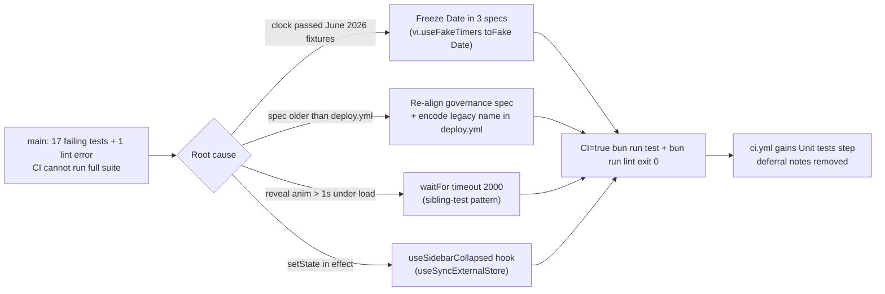

## Fix main's red tests and lint, then run the full unit suite on every PR

`main` fails 17 unit tests and 1 lint error. None of them is a production bug. 13 tests hard-code June 2026 dates and broke once the real clock passed them. 4 deploy-governance tests describe an older `deploy.yml`. 1 test flakes on timing under full-suite load. The lint error is a `setState` call inside an effect. We pin the clock in the date tests, re-align the governance spec with the deploy that actually ships, encode the legacy project name in `deploy.yml` (same deploy behavior), move the sidebar preference to `useSyncExternalStore`, and add the full `bun run test` step to PR CI.

### Flowchart (high-level)



### Task metadata

- Classification: `BUG_FIX` · `MEDIUM` · test suite + CI workflow + web shell (apps/api specs, apps/web, `.github/workflows`) · Deep for the `deploy.yml` line, Standard otherwise
- Docs loaded: `planning.md, plan-template.md`
- Backwards compatibility: `None`. No endpoint, DTO, DB, guard, or exported API symbol changes. The localStorage key `tyvera-sidebar-collapsed-v1` and its `"0"`/`"1"` values are unchanged. Deploy behavior is unchanged; see Phase 3.
- Claims reversed while investigating: (1) The handoff said `deploy.yml` lacks the dev-artifact smoke check. It has the check. The spec's single-line `curl` regex fails because `ff5699a` wrapped the command across lines. (2) The handoff listed 10 web failures. The full run also fails `tyvera-assistant-orchestration.test.tsx` "reveals streamed target text progressively". That test passes 3/3 when run alone, so it is load-sensitive.
- Root causes (RCA, code-proven):
  1. `assistant-read-model.service.ts` `validateMonthHorizon` accepts the current month through +3 using `new Date()`. The spec asks for `"2026-07"`, which is now in the past, so it throws `BOOKING_MONTH_OUT_OF_RANGE`.
  2. `assistant-mutation.service.ts:460` rejects `scheduledAt <= Date.now()` before the scope check. The spec's `2026-06-21` is now in the past, so it returns `INVALID_ASSISTANT_TOOL_ARGUMENTS` before `ASSISTANT_TARGET_OUT_OF_SCOPE`.
  3. `appointments/page.tsx` initializes `calendarMonth` and `month` from `new Date().toISOString().slice(0, 7)` (lines 167-169, 189). In 2026-10 the calendar renders October, so the June buttons and agenda never render (10 tests).
  4. `ff5699a` (2026-06-07, "build production images sequentially") changed `deploy.yml` on purpose:
     - timeouts went from 35/30m to 50/45m;
     - api and web now build sequentially before `up`;
     - it removed `docker compose -f docker-compose.yml down`. That line tore down the live stack before every build, because neither compose file sets `name:`, so both resolve to project `tyvera` and `--remove-orphans` removes prod;
     - it replaced `legacy_project="$(printf '\\163…')"` with the literal retired brand name. The doubled backslashes printed the escape digits instead of the name, so cleanup never worked. Verified locally: `printf '\\163\\165\\153\\151'` prints `\163\165\153\151`.

     The spec was never updated. The literal brand name now trips `rebrand-governance.spec.ts`.
  5. `use-progressive-assistant-text.ts` reveals text over ≥24 timer frames of 16 ms each. Under the full parallel suite this runs past `waitFor`'s 1000 ms default. Sibling tests in the same file already pass `{ timeout: 2000 }` (lines 712, 853).
  6. `adaptive-app-shell.tsx:71-77` reads localStorage in an effect and calls `setSidebarCollapsed` synchronously, which trips `react-hooks/set-state-in-effect`.
- User decision (2026-10-11): spec re-aligned to the current deploy, plus a 4-line `deploy.yml` change that encodes the legacy project name. Approved in chat.
- Plan deviation: the `deploy.yml` Old block shows the retired 4-letter brand name as `<LEGACY>`. In the file it is the plain lowercase name that `printf '\163\165\153\151'` decodes to. The literal stays out of this plan so the saved copy in `docs/plans/` passes `rebrand-governance.spec.ts`.
- Detected running model: Claude Opus 5.5 (`claude-opus-5-5`).
- Recommended model: `Opus`, medium, for every phase, so execution continues without a switch stop. Confidence high. Fallback: `Sonnet`, medium.
- Branch: `fix/no-ticket-main-test-failures` (from `origin/main` at `f979380`, which already includes PR #6)
- Release path: one branch → one PR into `main`, merge commit. Merging deploys production, and merging is the user's call.
- Required skills: `ecc:code-review`, `graphify`
- Execution preflight: `git fetch origin`, then `scripts/new-task-worktree.sh fix main-test-failures`, then `bun install --frozen-lockfile` in the worktree. The first commit is this plan, saved to `docs/plans/main-test-failures.md`.

### Phase 1 — RED (`Opus`, medium)

Only test files change here. No `src/` logic changes.

1. New file `apps/web/src/hooks/use-sidebar-collapsed.test.ts`:

```ts
import { afterEach, describe, expect, it } from "vitest";
import { act, renderHook } from "@testing-library/react";
import { useSidebarCollapsed } from "./use-sidebar-collapsed";

const STORAGE_KEY = "tyvera-sidebar-collapsed-v1";

describe("useSidebarCollapsed", () => {
  afterEach(() => {
    window.localStorage.clear();
  });

  it("edge: stays collapsed when no preference is stored", () => {
    const { result } = renderHook(() => useSidebarCollapsed());
    expect(result.current.collapsed).toBe(true);
  });

  it("edge: treats an unknown stored value as collapsed", () => {
    window.localStorage.setItem(STORAGE_KEY, "yes");
    const { result } = renderHook(() => useSidebarCollapsed());
    expect(result.current.collapsed).toBe(true);
  });

  it("regression: restores an expanded sidebar from storage on first render", () => {
    window.localStorage.setItem(STORAGE_KEY, "0");
    const { result } = renderHook(() => useSidebarCollapsed());
    expect(result.current.collapsed).toBe(false);
  });

  it("happy: toggle persists the preference and updates every subscriber", () => {
    const first = renderHook(() => useSidebarCollapsed());
    const second = renderHook(() => useSidebarCollapsed());

    act(() => first.result.current.toggle());
    expect(window.localStorage.getItem(STORAGE_KEY)).toBe("0");
    expect(first.result.current.collapsed).toBe(false);
    expect(second.result.current.collapsed).toBe(false);

    act(() => second.result.current.toggle());
    expect(window.localStorage.getItem(STORAGE_KEY)).toBe("1");
    expect(first.result.current.collapsed).toBe(true);
  });
});
```

2. Replace `apps/api/src/test/deploy-workflow-governance.spec.ts` with:

```ts
import { describe, expect, it } from "vitest";
import { execFileSync } from "node:child_process";
import { readFileSync } from "node:fs";

// Shell line continuations are joined so assertions pin commands, not how they wrap.
const readDeployWorkflow = () => {
  const repoRoot = execFileSync("git", ["rev-parse", "--show-toplevel"], { encoding: "utf8" }).trim();
  return readFileSync(`${repoRoot}/.github/workflows/deploy.yml`, "utf8").replace(/\s*\\\n\s*/g, " ");
};

describe("deploy workflow governance", () => {
  it("allows cold Docker rebuilds to finish before timing out", () => {
    const workflow = readDeployWorkflow();

    expect(workflow).toMatch(/timeout-minutes:\s*50\b/);
    expect(workflow).toMatch(/command_timeout:\s*45m\b/);
  });

  it("regression: removes legacy compose containers by the decoded legacy project name", () => {
    const workflow = readDeployWorkflow();

    // Single backslashes: printf decodes them. Doubled ones printed the escape digits instead.
    expect(workflow).toContain(`legacy_project="$(printf '\\163\\165\\153\\151')"`);
    expect(workflow).toContain(
      'docker compose -p "$legacy_project" -f docker-compose.yml down --remove-orphans || true',
    );
    expect(workflow).toContain(
      'docker compose -p "$legacy_project" -f docker-compose.prod.yml down --remove-orphans || true',
    );
    expect(workflow).not.toMatch(/down --volumes/);
    expect(workflow).not.toMatch(/down -v/);
  });

  it("regression: never tears down the default compose project, which production shares", () => {
    const workflow = readDeployWorkflow();

    expect(workflow).not.toMatch(/docker compose -f docker-compose\.yml down/);
  });

  it("fails deployment if the public web response still serves dev artifacts or localhost API URLs", () => {
    const workflow = readDeployWorkflow();

    expect(workflow).toMatch(/public_web_html="\$\(mktemp\)"/);
    expect(workflow).toMatch(/curl -fsS --max-time 15 https:\/\/tyvera\.app\/sign-up -o "\$public_web_html"/);
    expect(workflow).toContain("public_web_js_urls");
    expect(workflow).toContain("https://tyvera.app$js_path");
    expect(workflow).toMatch(/hmr-client/);
    expect(workflow).toMatch(/next-devtools/);
    expect(workflow).toContain(".next/dev");
    expect(workflow).toMatch(/http:\/\/localhost:3001/);
  });
});
```

3. `apps/api/src/help/assistant-read-model.service.spec.ts`
Old:
```ts
import { beforeEach, describe, expect, it, vi } from "vitest";
```
New:
```ts
import { afterEach, beforeEach, describe, expect, it, vi } from "vitest";
```
Old:
```ts
describe("AssistantReadModelService", () => {
  beforeEach(() => {
    vi.clearAllMocks();
    appointments.list.mockResolvedValue([]);
```
New:
```ts
describe("AssistantReadModelService", () => {
  // Fixtures use June 2026 dates and validateMonthHorizon reads the clock.
  beforeEach(() => {
    vi.clearAllMocks();
    vi.useFakeTimers({ toFake: ["Date"] });
    vi.setSystemTime(new Date("2026-06-07T10:00:00.000Z"));
    appointments.list.mockResolvedValue([]);
```
Old:
```ts
    answerSource.getAiUsageSummary.mockResolvedValue({
      canonical: { tokensUsed: 20, tokensLimit: 100 },
    });
  });

  it("returns masked, capped customer lookup results without sensitive fields", async () => {
```
New:
```ts
    answerSource.getAiUsageSummary.mockResolvedValue({
      canonical: { tokensUsed: 20, tokensLimit: 100 },
    });
  });

  afterEach(() => {
    vi.useRealTimers();
  });

  it("returns masked, capped customer lookup results without sensitive fields", async () => {
```

4. `apps/api/src/help/assistant-mutation.service.spec.ts`
Old:
```ts
import { beforeEach, describe, expect, it, vi } from "vitest";
```
New:
```ts
import { afterEach, beforeEach, describe, expect, it, vi } from "vitest";
```
Old:
```ts
describe("AssistantMutationService", () => {
  beforeEach(() => {
    vi.clearAllMocks();
    vi.stubEnv("AUTH_SESSION_SECRET", "test-assistant-confirmation-secret");
```
New:
```ts
describe("AssistantMutationService", () => {
  // Reschedule fixtures use June 2026 dates and the service rejects past times.
  beforeEach(() => {
    vi.clearAllMocks();
    vi.useFakeTimers({ toFake: ["Date"] });
    vi.setSystemTime(new Date("2026-06-07T10:00:00.000Z"));
    vi.stubEnv("AUTH_SESSION_SECRET", "test-assistant-confirmation-secret");
```
Old:
```ts
      notes: "Original",
      visitRecordedAt: null,
    });
  });

  it("exposes only bounded lookup and reversible mutation tools", () => {
```
New:
```ts
      notes: "Original",
      visitRecordedAt: null,
    });
  });

  afterEach(() => {
    vi.useRealTimers();
  });

  it("exposes only bounded lookup and reversible mutation tools", () => {
```

5. `apps/web/src/app/(dashboard)/appointments/page.wizard.test.tsx`
Old:
```ts
import { describe, it, expect, vi, beforeEach } from "vitest";
```
New:
```ts
import { describe, it, expect, vi, beforeEach, afterEach } from "vitest";
```
Old:
```ts
describe("Appointments wizard component", () => {
  beforeEach(() => {
    vi.clearAllMocks();
```
New:
```ts
describe("Appointments wizard component", () => {
  // The page opens on the current month; fixtures live in June 2026. Only Date is
  // faked so Testing Library's waitFor keeps real timers.
  beforeEach(() => {
    vi.clearAllMocks();
    vi.useFakeTimers({ toFake: ["Date"] });
    vi.setSystemTime(new Date("2026-06-07T10:00:00.000Z"));
```
Old:
```ts
    setupApi();
  });

  it("does not show OTP or manager override guidance in booking section", async () => {
```
New:
```ts
    setupApi();
  });

  afterEach(() => {
    vi.useRealTimers();
  });

  it("does not show OTP or manager override guidance in booking section", async () => {
```

6. `apps/web/src/components/tyvera-assistant-orchestration.test.tsx` ("reveals streamed target text progressively")
Old:
```ts
    act(() => releaseDone?.());
    await waitFor(() => {
      expect(
        screen.getByText(
          /a deliberately long streamed answer finish now\./i,
        ),
      ).toBeInTheDocument();
    });
```
New:
```ts
    act(() => releaseDone?.());
    await waitFor(
      () => {
        expect(
          screen.getByText(
            /a deliberately long streamed answer finish now\./i,
          ),
        ).toBeInTheDocument();
      },
      { timeout: 2000 },
    );
```

Run `bun run tdd:red`. Expected: the hook test file does not load (module missing), and `regression: removes legacy compose containers…` fails. Commit as `test: pin clock in date fixtures, re-align deploy governance, cover sidebar preference hook`.

Done: `bun run tdd:red` exits 0 with the failing titles recorded.

### Phase 2 — Sidebar preference hook, lint fix (`Opus`, medium)

1. New file `apps/web/src/hooks/use-sidebar-collapsed.ts`:

```ts
import { useCallback, useSyncExternalStore } from "react";

const SIDEBAR_COLLAPSED_STORAGE_KEY = "tyvera-sidebar-collapsed-v1";

// Same-tab writes do not fire the `storage` event, so toggle notifies subscribers itself.
const listeners = new Set<() => void>();

function subscribe(listener: () => void) {
  listeners.add(listener);
  window.addEventListener("storage", listener);
  return () => {
    listeners.delete(listener);
    window.removeEventListener("storage", listener);
  };
}

// Collapsed unless the user expanded it ("0"), matching the server-rendered default.
function getSnapshot() {
  return window.localStorage.getItem(SIDEBAR_COLLAPSED_STORAGE_KEY) !== "0";
}

function getServerSnapshot() {
  return true;
}

export function useSidebarCollapsed() {
  const collapsed = useSyncExternalStore(subscribe, getSnapshot, getServerSnapshot);

  const toggle = useCallback(() => {
    window.localStorage.setItem(
      SIDEBAR_COLLAPSED_STORAGE_KEY,
      getSnapshot() ? "0" : "1",
    );
    for (const listener of listeners) listener();
  }, []);

  return { collapsed, toggle };
}
```

Reuse check: `apps/web/src/hooks` has no storage hook (`use-account-freshness`, `use-auth-sync`, `use-billing-status`, `use-feature-flags`, `use-onboarding-progress`, `use-plan-capabilities`, `use-session`). No `useSyncExternalStore` exists in `apps/web/src`. The hook gets its own file so it can be tested without rendering the shell's workspace, auth, and plan providers.

2. `apps/web/src/components/navigation/adaptive-app-shell.tsx`
Old:
```tsx
import { getOpenManualFollowUpCount } from "@/components/needs-attention/manual-follow-up.api";

const SIDEBAR_COLLAPSED_STORAGE_KEY = "tyvera-sidebar-collapsed-v1";
const SIDEBAR_COLLAPSED_WIDTH = 72;
```
New:
```tsx
import { getOpenManualFollowUpCount } from "@/components/needs-attention/manual-follow-up.api";
import { useSidebarCollapsed } from "@/hooks/use-sidebar-collapsed";

const SIDEBAR_COLLAPSED_WIDTH = 72;
```
Old:
```tsx
  const [drawerOpen, setDrawerOpen] = useState(false);
  const [sidebarCollapsed, setSidebarCollapsed] = useState(true);
  const [sidebarPreferenceReady, setSidebarPreferenceReady] = useState(false);

  useEffect(() => {
    if (typeof window === "undefined") return;
    const raw = window.localStorage.getItem(SIDEBAR_COLLAPSED_STORAGE_KEY);
    if (raw === "0") setSidebarCollapsed(false);
    if (raw === "1") setSidebarCollapsed(true);
    setSidebarPreferenceReady(true);
  }, []);

  useEffect(() => {
    if (!sidebarPreferenceReady || typeof window === "undefined") return;
    window.localStorage.setItem(
      SIDEBAR_COLLAPSED_STORAGE_KEY,
      sidebarCollapsed ? "1" : "0",
    );
  }, [sidebarCollapsed, sidebarPreferenceReady]);
```
New:
```tsx
  const [drawerOpen, setDrawerOpen] = useState(false);
  const { collapsed: sidebarCollapsed, toggle: toggleSidebarCollapsed } =
    useSidebarCollapsed();
```
Old:
```tsx
                onClick={() => setSidebarCollapsed((current) => !current)}
```
New:
```tsx
                onClick={toggleSidebarCollapsed}
```
(`useEffect` stays imported; line 37 still uses it.)

3. Assistant-context governance (`docs/ai/planning.md`): this change touches `apps/web/src/components/`.
   - `docs/assistant-context/en/dashboard.md`: change `lastUpdated: 2026-05-10` to `lastUpdated: 2026-10-11`. After the `- Use this page as your daily starting point…` bullet, add `- The desktop sidebar remembers whether you collapsed or expanded it in this browser, and other open tabs follow the change.` English only per the user rule, so `tl/` is not touched.
   - `docs/ai/file-index/repository-map.md`, hooks row. Old `| billing status, workspace sync, other feature hooks |` → New `| billing status, workspace sync, sidebar collapse preference, other feature hooks |`.
   - `docs/ai/architecture-manifest.md`. After `- Shared feature UI under \`apps/web/src/components\``, add `- Dashboard shell \`apps/web/src/components/navigation/adaptive-app-shell.tsx\` reads the desktop sidebar preference through \`apps/web/src/hooks/use-sidebar-collapsed.ts\` (localStorage key \`tyvera-sidebar-collapsed-v1\`)`.

Done: the hook tests pass, `bun run lint` exits 0, and `bun run check:assistant-context-governance` passes.

### Phase 3 — `deploy.yml` legacy-name encoding (`Opus`, medium)

`.github/workflows/deploy.yml`
Old:
```yaml
            echo "removing legacy <LEGACY> containers if they still exist"

            docker compose \
              -p <LEGACY> \
              -f docker-compose.yml \
              down \
              --remove-orphans || true

            docker compose \
              -p <LEGACY> \
              -f docker-compose.prod.yml \
              down \
              --remove-orphans || true
```
New:
```yaml
            # Octal escapes keep the retired brand name out of tracked files.
            legacy_project="$(printf '\163\165\153\151')"

            echo "removing legacy compose containers if they still exist"

            docker compose \
              -p "$legacy_project" \
              -f docker-compose.yml \
              down \
              --remove-orphans || true

            docker compose \
              -p "$legacy_project" \
              -f docker-compose.prod.yml \
              down \
              --remove-orphans || true
```
INFRASTRUCTURE analysis:
- Current state: literal project name.
- Change: the same name, produced by `printf` (single backslashes inside a YAML `|` block reach the shell unchanged).
- Deploy impact: none if decoding works. If it ever decoded wrong, both commands are already `|| true`, so the deploy continues and only the legacy cleanup is skipped. The legacy containers were very likely removed by the June deploys anyway.
- Secrets and config: none.
- Rollback: revert the commit.
- Validation: the governance spec plus a local `sh -c` decode check (Validation section).

Done: the deploy and rebrand governance specs pass.

### Phase 4 — CI step and docs (`Opus`, medium)

1. `.github/workflows/ci.yml`
Old:
```yaml
          if [ -n "$web" ]; then (cd apps/web && bunx eslint --no-warn-ignored $web); fi
          if [ -n "$rest" ]; then bunx eslint --no-warn-ignored $rest; fi

      - name: Workflow script tests
```
New:
```yaml
          if [ -n "$web" ]; then (cd apps/web && bunx eslint --no-warn-ignored $web); fi
          if [ -n "$rest" ]; then bunx eslint --no-warn-ignored $rest; fi

      - name: Unit tests
        env:
          CI: "true"
        run: bun run test

      - name: Workflow script tests
```
2. `CLAUDE.md` "Tests" bullet. Old: `PR CI (\`.github/workflows/ci.yml\`) runs \`tdd:gate\`, \`typecheck\`, changed-file lint, \`test:scripts\`, and \`agents:lint\` when persona files change; the full \`bun run test\` is not a CI step yet because \`main\` carries pre-existing API test failures.` → New: `PR CI (\`.github/workflows/ci.yml\`) runs \`tdd:gate\`, \`typecheck\`, changed-file lint, the full unit suite (\`bun run test\` with \`CI=true\`), \`test:scripts\`, and \`agents:lint\` when persona files change.`
3. `docs/ai/testing-strategy.md` line 31. Old: `…(\`apps/web\` files lint from \`apps/web\` so its Next config applies; everything else uses the root config), \`bun run test:scripts\`, and \`bun run agents:lint\` when persona files change. The full \`bun run test\` is not a CI step yet: \`main\` carries pre-existing API test failures, and the step is added once they are fixed.` → New: `…(\`apps/web\` files lint from \`apps/web\` so its Next config applies; everything else uses the root config), the full unit suite (\`bun run test\` with \`CI=true\`), \`bun run test:scripts\`, and \`bun run agents:lint\` when persona files change.`

Done: `git grep -n "not a CI step"` returns nothing outside `graphify-out/`.

### Validation and acceptance

Test Matrix:

| layer | required? | file | cases |
|---|---|---|---|
| unit (guarded `.ts` hook) | required | `apps/web/src/hooks/use-sidebar-collapsed.test.ts` | edge: no stored value → collapsed; edge: unknown value → collapsed; regression: `"0"` → expanded on first render; happy: toggle persists and syncs subscribers |
| component (guarded `.tsx` shell) | covered by the hook test; waiver: the shell change only rewires `sidebarCollapsed` and the toggle `onClick` to the hook, and rendering the shell needs workspace, auth, and plan providers that no existing test sets up | — | — |
| regression (governance) | required | `apps/api/src/test/deploy-workflow-governance.spec.ts`, `rebrand-governance.spec.ts` (unchanged, must pass) | regression: legacy cleanup by decoded name; regression: no default-project teardown |
| regression (date fixtures) | required | the 3 frozen-clock specs above | the existing titles pass with the clock pinned to 2026-06-07T10:00Z |
| integration (Nest) | not required: no endpoint, provider, or scheduler change | — | — |
| smoke | not required for runtime code beyond the shell: `bun run build` (web) still runs because of the `.tsx` change | — | — |

Run, from the worktree root:
- `bun run typecheck`
- `bun run lint`, expect exit 0
- `CI=true bun run test -- --force`, expect exit 0. Run it 3 times to check the timing flake under load.
- `bun run test:scripts`
- `bun run check:assistant-context-governance`
- `bun run --cwd apps/web build`
- Decode check: `sh -c 'printf "\163\165\153\151"' | wc -c` → `4`, and the output matches the legacy name (compare via `od -c`; do not commit it).
- Local gate dry-run: `TDD_GATE_BASE=origin/main PR_BODY="" bun run tdd:gate`, expect `ok: TDD gate passed` with a RED note.
- Graphify gate: load `graphify`, run `/graphify . --update`, and report the graph diff and tokens. Then re-run `cd apps/api && ../../node_modules/.bin/vitest run src/test/rebrand-governance.spec.ts` so the regenerated graph files hold no legacy term.

Mock and seed data: none. No database is touched.

### Compatibility, docs, and scans

- Public surfaces: none changed. The localStorage key and values are the same. One additive behavior: other tabs follow a sidebar toggle through the `storage` event. The initial render still defaults to collapsed (`getServerSnapshot` → `true`), so hydration output is unchanged. Before, the shell wrote `"1"` on first mount when nothing was stored; now it writes only on toggle, and a missing key still means collapsed.
- Docs updated in the same PR: `CLAUDE.md`, `docs/ai/testing-strategy.md`, `docs/assistant-context/en/dashboard.md`, `docs/ai/file-index/repository-map.md`, `docs/ai/architecture-manifest.md`, `docs/plans/main-test-failures.md`.
- PR evidence: follow `docs/ai/pr-evidence.md` sections 3 (bug fix) and 7 (CI/workflow). The PR body carries the test, lint, and gate outputs. English only.
- Residual risk: the reveal timing test is still real-timer based. 2000 ms matches its siblings. If CI runners prove slower, the durable fix is to drive `use-progressive-assistant-text` with fake timers. That is out of scope here.
- Optimization scan: not worth it, left as-is. The CI job's 15-minute timeout is checked against the first CI run's duration.
- Data impact: none.
