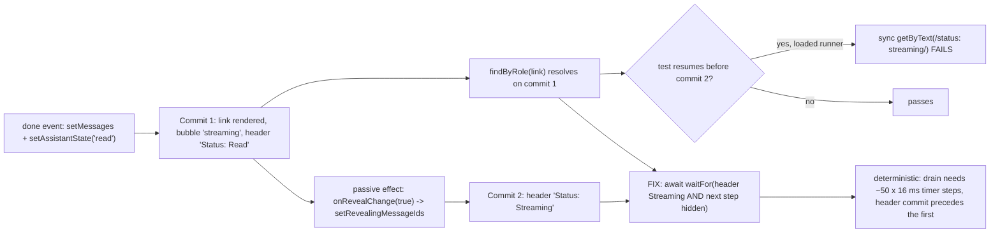

## Deterministic "drains the final next step progressively" test

The web test `regression: drains the final next step progressively and keeps status streaming`
(`apps/web/src/components/suki-assistant-orchestration.test.tsx:697`) fails intermittently on
loaded runners. Root cause: the test reads the header status synchronously on the first commit
that renders the action link, but in that commit the header still says `Status: Read`; it flips
to `Status: Streaming` one commit later. The test passes only when that second commit happens to
land before the test resumes. The fix waits for that commit (`waitFor`) instead of reading the
first one. Test-only change; no `src/` change.

### Flowchart (high-level)



### Task metadata

- Classification: `BUG_FIX` · `SMALL` · web / Suki Assistant tests · low (test-only)
- Docs loaded: planning.md, plan-template.md
- Backwards compatibility: `None` (test file only; no public surface touched)
- Claims reversed while investigating: none. (Candidate "the reveal drain finishes before the assertion" was never asserted; the instrumented run ruled it out: on failure `nextStepVisible=false`, `bubbleStreaming=1`.)
- Root cause: `SukiAssistant` header state `displayedAssistantState` (`apps/web/src/components/suki-assistant.tsx:197-200`) depends on `revealingMessageIds`, which is only updated from the child's passive effect `onRevealChange` (`apps/web/src/components/assistant/use-progressive-assistant-text.ts:79-83` -> `handleRevealChange`, `suki-assistant.tsx:180-195`). The `done` handler (`suki-assistant.tsx:499-515`) sets the message (with chips) and `assistantState = "read"` in one render, so commit 1 shows the link with header `Status: Read`; commit 2 (after the effect) shows `Status: Streaming`. The test (`suki-assistant-orchestration.test.tsx:710-716`) asserts synchronously right after `findByRole("link")`, which resolves on commit 1.
- Why PR #8 (905e240) did not fix it: it forced reduced motion for other tests and raised timeouts (`asyncUtilTimeout` 5 s, `testTimeout` 15 s, final `findByText` 10 s). The failing assertion is a synchronous `getByText`, so no timeout applies to it.
- Detected running model: Opus 5.5 (`claude-opus-5-5`).
- Recommended model: Opus 5.5, medium; confidence high. Fallback: Sonnet 5.5 medium.
- Branch: `fix/no-ticket-orchestration-test-flake` (from `origin/main` 8393ee3)
- Release path: one branch -> one PR into `main`, merge commit. Merging deploys production. Parent merges.
- Required skills: graphify (closeout)
- Execution preflight: this session's worktree is already a clean checkout of `origin/main` 8393ee3 (session-assigned worktree, per parent brief "work only in your own worktree"); `git fetch origin`, then `git switch -c fix/no-ticket-orchestration-test-flake origin/main` in it. Deviation from `scripts/new-task-worktree.sh`: no second worktree, because the session already owns a fresh one. Deps already installed.

### Evidence (reproduction)

Load: 22 `yes > /dev/null` CPU hogs on an 11-core Mac; each run = fresh `CI=true bunx vitest run src/components/suki-assistant-orchestration.test.tsx -t "drains the final next step"` from `apps/web` (one process per run, so per-process overhead is identical across before/after samples).

| Sample | Test version | Failed / runs |
|---|---|---|
| before-load22 | original | 2 / 20 (both at line 713, `Unable to find an element with the text: /status:\s*streaming/i`) |
| dbg | original + one `console.log` before line 713 | 1 / 20; failing run logged `header="Status: Read" bubbleStreaming=1 nextStepVisible=false`; 19 passing runs logged `header="Status: Streaming"` |
| before2 | original | 0 / 40 |
| **before total** | original | **3 / 80 (3.75%)** |
| after | fixed (below) | **0 / 60** |

3/80 vs 0/60 alone is not statistically decisive, so the mechanism was proven deterministically with a temporary probe test (deleted, never committed): a `MutationObserver` recording the header text on every DOM mutation once the `/insights` link exists. Result, 20/20 runs identical:
`link+Status: Read > link+Status: Streaming > link+Status: Read`.
The state the original test can observe on resume (link present, header `Read`) exists in every run; whether it is observed depends only on scheduling. Evidence FOR the root cause: the probe + the failing run's log. Observation that would DISPROVE it: any probe run whose first linked state is `Status: Streaming`, or a failing run logging `header="Status: Streaming"`. Neither occurred.

Determinism of the fix: the `waitFor` passes on commit 2 (MutationObserver-triggered check). It could only fail if the next step became visible before commit 2. Impossible by construction: the header update is enqueued in commit 1's passive-effect flush, the same flush that schedules the first 16 ms drain timer (`use-progressive-assistant-text.ts:52-66`); the full text needs ~50 sequential timer steps (batch = `ceil(remaining/24)`, 1 char per step for the last 24 chars). The probe's middle state confirms `Streaming` is reached while the link is shown and before the final `Read`.

### Product observation (not fixed, reported per brief)

After a `done` event the header shows `Status: Read` for one commit before `Status: Streaming` (state lifted via effect). Real but a one-commit flicker; the final state is correct and the message bubble already shows `streaming` in commit 1. Not changed here (no `src/` edit; out of scope). Parent decides whether it merits a separate task (durable version: derive the header from message reveal state without the effect hop).

### Phase 1 — Test fix (`Opus 5.5`, medium)

RED note: no workspace `src/` logic change, so `tdd:red` does not apply; the failing proof is the load reproduction above. `tdd:gate` only demands tests when logic files change (`scripts/ci/tdd-gate.mjs`, `behaviourChanged = groups.logic.length > 0`).

1. `docs/plans/orchestration-test-flake.md`: this plan, first commit (`docs(plans): add orchestration test flake plan`).
2. `apps/web/src/components/suki-assistant-orchestration.test.tsx`

Old:
```tsx
    expect(
      await screen.findByRole("link", { name: /open insights/i }),
    ).toBeInTheDocument();
    expect(screen.getByText(/status:\s*streaming/i)).toBeInTheDocument();
    expect(
      screen.queryByText(/open insights to review everything\./i),
    ).not.toBeInTheDocument();
```
New:
```tsx
    expect(
      await screen.findByRole("link", { name: /open insights/i }),
    ).toBeInTheDocument();
    // The header status is lifted from the reveal hook through an effect, so it
    // reaches "Streaming" one commit after the link renders; wait for that commit.
    await waitFor(() => {
      expect(screen.getByText(/status:\s*streaming/i)).toBeInTheDocument();
      expect(
        screen.queryByText(/open insights to review everything\./i),
      ).not.toBeInTheDocument();
    });
```
(`waitFor` already imported, line 2.) Commit: `test(web): wait for the streaming header commit in the progressive drain test`.

Done: diff equals the block above; 0 failures in 60 loaded runs.

### Validation and acceptance

| layer | required | file | cases |
|---|---|---|---|
| web component (vitest/jsdom) | required: the flaky test itself | `apps/web/src/components/suki-assistant-orchestration.test.tsx` | regression: drains the final next step progressively and keeps status streaming (intent unchanged: header `Streaming` + next step hidden while draining, then header `Read` + next step shown) |
| api / db / types / scripts | not required: untouched | — | — |

Regression guard kept: if the product stopped holding `Streaming` during the drain, or revealed instantly, the `waitFor` times out (5 s `asyncUtilTimeout`) and fails.

Acceptance: "test deterministic" -> test file -> step 2 -> 60 loaded runs with 0 failures + full suite green.

Run:
- `bun run typecheck`, `bun run lint`, `CI=true bun run test`, `bun run test:scripts`, `TDD_GATE_BASE=origin/main bun run tdd:gate`, `bun run build`
- 60 loaded repeat runs (22 hogs) of the single test.
- Graphify gate: `graphify update .` (code-only change), report graph diff.

### Compatibility, docs, and scans

- No public surface; no migration; no docs/ai change.
- Rejected simpler alternative: raising timeouts (does not apply to a synchronous `getByText`; PR #8 already did). Fake timers rejected: larger change, and the test intentionally exercises the real-timer reveal.
- Optimization scan: not worth it, left as-is.
- Data impact: none.
- Cleanup: scratch stress logs in session scratchpad removed at close.
